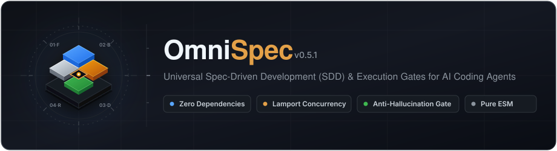

<p align="center">
  
</p>

<p align="center">
  <a href="package.json"></a>
  <a href="docs/releases/0.8.0-preview.3.md"></a>
  <a href="package.json"></a>
  <a href="package.json">=22.19.0"></a>
  <a href="LICENSE"></a>
  <a href="https://github.com/brahiandres1999-oss/omni-spec/actions/workflows/ci.yml"></a>
</p>

---

# OmniSpec 0.8.0-preview.3

> **Desarrollo Guiado por Especificaciones (SDD) para Agentes de IA.**  
> Escribe especificaciones claras, elimina el código de relleno (*AI slop*) y programa con tu agente favorito sin perder el control ni el contexto entre sesiones.

Inspirado en los principios de **Spec-Kit** y **OpenSpec**, OmniSpec es un framework universal, sin dependencias runtime externas, con CLI portable y adaptadores según formatos documentados que vive dentro de tu repositorio. Funciona directamente desde el chat de tu editor preferido (Cursor, VS Code, Claude Code, Antigravity y más), soportando instalación directa como **Plugin nativo en Google Antigravity** y subagentes autónomos de auditoría (`omni-auditor`).

---

> **0.8.0 Preview — lanzamiento en preparación.** Esta rama prepara `0.8.0-preview.3` para distribución pública en el canal npm `preview` y como prerelease en GitHub. Es una versión para probar y recibir feedback, con validaciones pendientes. `0.6.1` sigue en npm `latest` (consultado el 2026-10-28). Consulta las [notas de la Preview](docs/releases/0.8.0-preview.3.md) y el [piloto local](docs/PILOT.md).

## ¿Por qué OmniSpec?

Los agentes de IA son rápidos, pero sin un marco estructurado sufren de amnesia de contexto, sobreingeniería en backend (*defensive try/catch traps*, abstracciones prematuras) y clichés visuales genéricos en frontend (*card-itis*, degradados morados, estados vacíos rotos).

OmniSpec resuelve esto con un ciclo de ingeniería riguroso:

- **Criterios de calidad explícitos:** Aporta instrucciones de UI/UX y backend para guiar la implementación y revisión. La calidad visual, accesibilidad y corrección requieren comprobaciones pertinentes; las instrucciones no garantizan un resultado correcto al primer intento.
- **Zero Dependencies & Zero Lock-in:** Node.js nativo (>=22.19.0). No instala paquetes npm pesados ni altera el runtime de proyectos en Python, Go, Rust, Java o TypeScript.
- **Universal Multi-Agent:** Un único comando configura Cursor, GitHub Copilot, Claude Code, Google Antigravity, OpenCode, Kilo, Codex o cualquier LLM con soporte Markdown.
- **Verificación que convive con proyectos reales:** la huella respeta `.gitignore`, `.omnispecignore` y exclusiones por defecto (reportes de Playwright, `.gradle/`, `build/`, IDE). Si un check modifica un archivo no ignorado, `verify` lo nombra en vez de fallar sin explicación.
- **Verificación con alcance declarado:** Ejecuta los gates configurados y vincula el registro al contenido del proyecto y de la spec. `acceptance.json` registra evidencia declarada por criterio; los criterios automatizados deben referenciar gates configurados mediante `checkCommands`, y el CLI los vincula con sus resultados ejecutados. La suficiencia de esas pruebas y la veracidad de evidencia manual requieren revisión. Un snapshot detecta cambios posteriores, no demuestra ausencia de regresiones.

---

## Empezar con 0.8.0 Preview

### 1. Prepara la carpeta donde vas a trabajar

Necesitas Node.js >=22.19.0 y una herramienta con agente de IA. OmniSpec prepara instrucciones y conserva acuerdos en tu proyecto; tu agente conduce la conversación y realiza el trabajo. No necesitas elegir las tecnologías de tu aplicación para instalar OmniSpec.

Abre una terminal en la carpeta del proyecto. Para uno nuevo, crea una carpeta y entra en ella; para uno existente, usa su raíz. Genera el tarball como explica el [piloto](docs/PILOT.md) y utiliza la ruta de ese archivo:

```sh
npm exec --offline --yes --package "/ruta/al/omni-spec-0.8.0-preview.2.tgz" -- omni-spec init
```

Una vez publicada la Preview, el punto de entrada será `npx --yes omni-spec@preview init`; también podrá fijarse `@0.8.0-preview.2`. `@latest` seguirá ejecutando 0.6.1 mientras no se promueva una versión normal. Antes de publicar, utiliza el tarball local. La instalación global es opcional.

En la candidata 0.7.0, el asistente pregunta idioma, herramienta con IA y confirmación de la carpeta. Permite varias herramientas o `generic` si aún no elegiste una. No presupone Antigravity ni pregunta tu nivel de experiencia. Producto, stack, documentación y checks se acuerdan después con el agente. `init` conserva el código existente y no ejecuta scripts de aplicación; los comandos detectados quedan como candidatos en `specs/project-context.md`.

En una terminal compatible verás el logo de caracteres y una pregunta activa: flechas para moverte, Espacio para marcar herramientas y Enter para continuar; Esc o Ctrl+C cancelan. La presentación se ajusta al tamaño disponible. Usa `--plain` para texto por líneas; tuberías, CI y JSON conservan salida sencilla. `NO_COLOR` desactiva los colores. Antigravity recibe también `.agents/agents/omni-auditor.md` para las superficies que admiten ese formato.

El `--yes` **antes** del paquete pertenece a npm: evita su confirmación de descarga, pero el asistente de OmniSpec sigue siendo interactivo. Para automatización, añade el `--yes` de OmniSpec **después** de `init` y declara la integración:

```sh
npm exec --offline --yes --package "/ruta/al/omni-spec-0.8.0-preview.2.tgz" -- omni-spec init --yes --agent codex --lang es
# También admite --agent cursor,claude o --agent all.
```

Los argumentos `--name`, `--stack`, `--doc`, `--profile`, `--gates` y `--ui-components` permiten conservar decisiones explícitas sin repetir preguntas. Sin una integración declarada en modo automático se utiliza `generic`, con prompts de lectura explícita. [Todas las variantes de instalación y recuperación](docs/INSTALLATION.md).

Las directrices de diseño y calidad de interfaz están integradas directamente en el motor mediante `guide design` (`node specs/.omni/runtime/bin/omni-spec.mjs guide design`), sin necesidad de instalar skills ni paquetes externos.

### 2. Reconoce el proyecto desde el chat

Abre **esa misma carpeta** en tu herramienta con IA y usa la invocación que muestra el instalador. Por ejemplo, `/omni-init` en Claude o `$omni-init` en Codex. La instalación comprueba integridad local; todavía no confirma que el host descubra las skills.

Si la skill no aparece, actualiza/reabre el proyecto o pega en el chat:

```text
Lee specs/commands/omni-init.md y sigue la ruta de la skill que indica.
Confirma la versión del runtime local y usa el idioma de esta conversación.
```

Explica qué quieres construir o cambiar. El agente reconocerá el punto de partida y registrará objetivos, decisiones pendientes y contexto en `specs/project-context.md`. Instalar OmniSpec no crea ni valida la aplicación. Una instalación ya existente conserva su configuración y trabajo activo; una versión diferente se migra con `update --dry-run`, no con `init`.

La entrada `specs/commands/omni-init.md` apunta a la skill de tu integración; no copia el workflow completo. En modo `generic`, los prompts de `specs/commands/` sí son la vía principal.

### 3. Especifica, construye y verifica

Trabaja de forma interactiva usando los comandos de slash:

```text
/omni-specify Agrega autenticación con Google y Passkeys
/omni-plan
/omni-tasks
/omni-implement
/omni-converge
```

---

## El Flujo de Trabajo (Los 9 Skills)

OmniSpec guía el desarrollo a través de un ciclo continuo de 9 habilidades universales:

| Comando | Fase | Propósito |
| :--- | :--- | :--- |
| `/omni-init` | **Onboarding** | Reconoce la arquitectura, stack, comandos reales y convenciones del repositorio. |
| `/omni-discuss` | **Exploración** | Investiga alternativas, analiza trade-offs y compara enfoques antes de tocar archivos. |
| `/omni-specify` | **Especificación** | Formaliza el alcance y los criterios de aceptación en un arquetipo concreto. |
| `/omni-clarify` | **Alineación** | Pregunta y resuelve dudas materiales y casos borde antes de diseñar la solución. |
| `/omni-plan` | **Arquitectura** | Diseña una solución técnica proporcional, minimalista y con estrategia de testing. |
| `/omni-tasks` | **Planificación** | Desglosa la solución en tareas ejecutables con orden de dependencias. |
| `/omni-audit` | **Control de Calidad** | Audita consistencia documental, completitud y gates antes de escribir código. |
| `/omni-implement` | **Construcción** | Cirugía de código de alta precisión: minimal touch, calidad senior y sin comentarios de relleno. |
| `/omni-converge` | **Verificación** | Ejecuta gates automáticos, valida criterios de aceptación y cierra el trabajo con evidencia. |

---

## Arquetipos de Trabajo

OmniSpec adapta los artefactos generados según la naturaleza exacta de la tarea:

| Arquetipo | Alias | Artefactos generados | Cierre requerido |
| :--- | :--- | :--- | :--- |
| `feature` | `feat` | `spec.md`, `plan.md`, `tasks.md` | Criterios medibles, pruebas unitarias/E2E y verificación. |
| `bugfix` | `bug`, `fix` | `bug.md`, `rca.md`, `fix.md` | Reproducción demostrada, causa raíz (RCA) y test de regresión. |
| `debt` | `refactor` | `audit.md`, `migration-plan.md`, `tasks.md` | Reducción de deuda preservando 100% el comportamiento existente. |
| `rfc` | `idea` | `rfc.md` | Decisión formal consensuada (`ACCEPTED`, `REJECTED`, `DEFERRED`). |

---

## Agentes y Editores Compatibles

OmniSpec genera adaptadores nativos para cada entorno sin dependencias propietarias. Todos los agentes reciben además un bloque gestionado en `AGENTS.md`, que es el único archivo que todos los hosts documentan.

| Agente / Editor | Archivos generados | Cómo se invoca |
| :--- | :--- | :--- |
| **Google Antigravity** | `.agents/skills/omni-*/SKILL.md` y `.agents/agents/omni-auditor.md`, o Plugin nativo | `/omni-init` o gestor `/plugin` |
| **Cursor** | `.cursor/skills/omni-*/SKILL.md` + regla de proyecto | `/omni-init` en Cursor Composer / Chat |
| **VS Code (GitHub Copilot)** | `.agents/skills/omni-*/SKILL.md` + instrucciones | `/omni-init` en Chat de Copilot |
| **Claude Code** | `.claude/skills/omni-*/SKILL.md` | `/omni-init` en Claude CLI |
| **Kilo** | `.kilo/skills/omni-*/SKILL.md` + `.kilo/commands/omni-*.md` | `/omni-init` en consola interactiva |
| **OpenCode** | `.opencode/skills/omni-*/SKILL.md` | `/omni-init` en consola interactiva |
| **Gemini CLI** | `.gemini/skills/omni-*/SKILL.md` + `.gemini/commands/omni-*.toml` | `/omni-init` en Gemini Code Assist |
| **Codex** | `.agents/skills/omni-*/SKILL.md` | `$omni-init` o selector de skills |
| **Genérico / Cualquier LLM** | `specs/commands/omni-*.md` | Pide al agente que lea y ejecute el prompt |

`.agents/skills/` es la ruta de interoperabilidad: la leen Antigravity, Copilot, Codex, Cursor, Kilo y OpenCode. El adaptador `antigravity` produce el árbol más portable.

### Uso como Plugin Nativo en Google Antigravity

OmniSpec incluye un manifiesto `plugin.json` en la raíz para ser consumido como un plugin modular con espacio de nombres en Google Antigravity:

```sh
# Enlaza OmniSpec directamente a tu configuración local de plugins de Antigravity:
npm run sync:plugin
```

Esto expone los 9 comandos de slash, la Constitución y el subagente `omni-auditor` en todos tus proyectos dentro de Antigravity sin necesidad de instalar archivos en cada repositorio.

El manifiesto se mantiene dentro del esquema publicado de Antigravity (`$schema`, `name`, `description`). Los campos que el runtime de Antigravity reconoce pero cuyos nombres no están documentados (icono y prompts sugeridos) viven aparte en `plugin.extra.json` hasta que Google publique el contrato. Tras instalar, `omni-spec plugin install` ejecuta `agy plugin validate --strict --json` cuando la CLI de Antigravity está disponible y falla si el bundle no valida.

Para añadir o cambiar adaptadores en cualquier momento:

```sh
node specs/.omni/runtime/bin/omni-spec.mjs setup-agent cursor,copilot,claude
```

---

## Referencia del CLI

Usa el runtime instalado (`node specs/.omni/runtime/bin/omni-spec.mjs <comando>`) o el tarball del [piloto](docs/PILOT.md). Después de publicar la Preview, los comandos por nombre serán los siguientes. `@preview` selecciona la Preview; `@latest` conserva la versión normal publicada.

```sh
# Inspección y diagnóstico
npx omni-spec@preview status                 # Muestra el estado del proyecto y trabajo activo
npx omni-spec@preview status --json --all    # Incluye la aceptación y las decisiones de specs cerradas
npx omni-spec@preview doctor                 # Verifica integridad de archivos y adaptadores
npx omni-spec@preview inspect --json         # Muestra tecnologías, módulos y comandos detectados

# Gestión de especificaciones
npx omni-spec@preview create feature auth    # Crea manualmente un nuevo trabajo estructurado
npx omni-spec@preview list                   # Lista todas las especificaciones activas y cerradas
npx omni-spec@preview focus 001              # Enfoca el trabajo activo en la spec 001

# Ceremonia proporcional al cambio
npx omni-spec@preview fit 001                # Pregunta y deriva la ruta: light, standard o full

# Contexto, sesión y decisiones
npx omni-spec@preview context-check          # Estructura y enlaces locales del contexto
npx omni-spec@preview context-record         # Guarda el baseline de entradas de contexto
npx omni-spec@preview session-record --from specs/.omni/inputs/session.json   # Capacidades reales del host
npx omni-spec@preview decision-record --from -   # Decisión/delegación leída de stdin
npx omni-spec@preview guide evidence         # Forma exacta de cada JSON (también: guide setup, guide design)

# Calidad y Verificación
npx omni-spec@preview audit 001              # Audita consistencia de artefactos y placeholders
npx omni-spec@preview checks --from specs/.omni/inputs/checks.json   # Catálogo de checks con ID y cwd por módulo
npx omni-spec@preview configure --gates "npm test"  # Gates heredados desde la raíz
npx omni-spec@preview verify 001             # Ejecuta los checks y liga la evidencia a la huella
npx omni-spec@preview complete 001           # Cierra el trabajo tras comprobar evidencia
npx omni-spec@preview contracts              # Contratos de capacidad vigentes y propuestos
npx omni-spec@preview contracts --active     # Solo los contratos activos, sin historial
```

### Qué atesta `verify`

`verify` ejecuta los checks aprobados y calcula una huella del proyecto. Quedan fuera las rutas de `.gitignore` (raíz y subcarpetas), `.git/info/exclude`, `.omnispecignore` (misma sintaxis, evaluado al final) y exclusiones por defecto como `node_modules/`, `dist/`, `build/`, `target/`, `coverage/`, `.gradle/`, `.idea/`, `.vscode/`, `test-results/` y `playwright-report/`. Si algo no ignorado cambia mientras corren los checks, la verificación falla y lista las rutas. `complete` solo cierra si nada cambió desde entonces. El contexto queda `STALE` cuando cambian sus entradas (manifiestos, CI, instrucciones de agentes o archivos que cita), no cuando cambia el código.

### Spec Fit: cuánta ceremonia merece un cambio

No todo cambio necesita el ciclo completo. OmniSpec incorpora **triaje dinámico** y atajos de ceremonia para evitar la burocracia documental innecesaria:

```sh
# Crear directamente una especificación en modo ligero (sin plan.md ni tasks.md):
omni-spec create feature arreglo-etiqueta --light

# O mutar y escalar la ruta según evoluciona el alcance técnico:
omni-spec fit --preset light      # Modo ligero: spec.md y acceptance.json únicamente
omni-spec fit --preset standard   # Modo estándar: añade diseño de arquitectura
omni-spec fit --preset full       # Modo completo: diseño, desglose de tareas y testing
```

| Ruta | Artefactos Requeridos | Cuándo Usarla |
| :--- | :--- | :--- |
| **light** | `spec.md` + `acceptance.json` | Cambio pequeño (1-2 archivos), local, claro y con tests existentes. |
| **standard** | `spec.md` + diseño (`plan.md` / `migration-plan.md` / `rca.md` + `fix.md`) | Cambio con incertidumbre de diseño o sin cobertura previa de pruebas. |
| **full** | `spec.md` + diseño + desglose de tareas (`tasks.md`) | ≥3 archivos, múltiples módulos, cambios de contratos públicos o riesgo elevado. |

La ruta se **deriva** de `specs/<slug>/fit.json` (mediante el cuestionario interactivo o los presets canónicos) y se evalúa automáticamente. En v2 se ponderan consecuencia (*risk*), incertidumbre (*uncertainty*) y reversibilidad (*reversibility*).

**Andamiaje dinámico en escalada:** Si un cambio ligero escala en complejidad, ejecutar `omni-spec fit --preset standard` o `--preset full` no solo actualiza las reglas de auditoría, sino que genera automáticamente en disco los artefactos faltantes (`scaffoldMissingRouteArtifacts`) preservando cualquier contenido o decisión previa sin sobreescrituras destructivas.

---

## Estándares de Ingeniería & Zero Slop Guard

OmniSpec actúa como un guardián de calidad (*The Guardian*) que neutraliza los vicios comunes de los modelos de lenguaje:

### Zero Slop Guard (5 Reglas Anti-Código Basura)
1. **Type-Slop:** Prohibido el uso de `any`, casteos ciegos (`as unknown as T`) o interfaces redundantes innecesarias.
2. **Mock-Slop:** Prohibidos tests que solo verifiquen que los mocks fueron llamados; se exigen pruebas de integración reales con lógica ejecutable.
3. **Visual-Slop:** Prohibidos los clichés genéricos de IA (degradados azul/púrpura sin justificación de marca, badges difusos y anidamiento excesivo de tarjetas con sombras o *card-itis*).
4. **Scope-Slop (YAGNI Estricto):** Prohibidas capas especulativas (factorías, DTOs, wrappers) o funciones auxiliares no solicitadas que no respondan directamente a un criterio de aceptación.
5. **Dependency-Slop:** Capacidades nativas de la plataforma primero; prohibido añadir dependencias externas para funciones nativas a menos que el usuario lo autorice expresamente.

### Sintaxis Formal EARS para Requisitos
Las especificaciones formulan sus criterios de aceptación (`AC-01 [kind]`) mediante la sintaxis estandarizada **EARS** (*Easy Approach to Requirements Syntax*):
- **Ubiquitous:** `<sistema> DEBERÁ <acción>` (ej. `AC-01 [functional]: El sistema DEBERÁ validar tokens al inicio`).
- **Event-driven:** `CUANDO <evento>, <sistema> DEBERÁ <acción>` (ej. `AC-02 [functional]: CUANDO el token sea inválido, el CLI DEBERÁ terminar con código 1`).
- **State-driven:** `MIENTRAS <estado>, <sistema> DEBERÁ <acción>` (ej. `AC-03 [interaction]: MIENTRAS los datos cargan, la UI DEBERÁ mostrar skeletons contextuales`).
- **Unwanted condition:** `SI <error>, ENTONCES <sistema> DEBERÁ <acción>` (ej. `AC-04 [functional]: SI la red falla, ENTONCES el cliente DEBERÁ ofrecer reintento`).

### Árbitro de Calidad UI (`guide design`)
Para cambios que involucran frontend, `guide design` establece las directivas vinculantes:
- **4 Estados Obligatorios de Interfaz:** Toda vista interactiva debe definir:
  1. *Loading*: skeletons contextuales o carga real con Cumulative Layout Shift (CLS) = 0.
  2. *Empty*: mensaje contextual claro con llamada a la acción inmediata (CTA).
  3. *Error*: mensaje comprensible (sin códigos crípticos) y mecanismo de reintento o recuperación.
  4. *Protected / Ideal*: contenido típico completo o vista restringida sin permisos.
- **Medición Empírica de Contraste:** Se prohíbe cerrar criterios visuales inspeccionando solo código o JSX; se exige comprobación empírica con ratios mínimos de 4.5:1 para texto estándar y 3:1 para componentes de UI o texto grande.

---

## Estructura en tu Repositorio

OmniSpec guarda el estado y los contratos en `specs/`, la constitución en la raíz y las integraciones en la ruta que lee cada host. Ejemplo con Antigravity; los registros de trabajo aparecen conforme se utiliza el flujo:

```text
├── AGENTS.md                   # Instrucciones compartidas, en una sección administrada
├── CONSTITUTION.md             # Reglas y decisiones del proyecto
├── .agents/
│   ├── skills/omni-*/SKILL.md   # Nueve skills de Antigravity
│   └── agents/omni-auditor.md   # Auditor del workspace cuando el host lo admite
└── specs/
    ├── project-context.md      # Contexto, decisiones y comandos con su estado de evidencia
    ├── manifest.json           # Estado del framework, spec activa e historial
    ├── project-state.json      # Baseline de contexto, sesiones y decisiones
    ├── checks.json             # Catálogo de checks aprobados (ID, cwd, timeout, tipo)
    ├── commands/omni-init.md    # Entrada breve a la skill; prompts completos en generic
    ├── manifest.lock/          # Tickets temporales de escritura; vacío en reposo
    ├── .gitignore              # Sección administrada: estado local (logs, backups, inputs) y runtime
    ├── _templates/             # Plantillas editables por arquetipo
    ├── 001-nombre-del-trabajo/ # Espacio de trabajo de la spec activa
    │   ├── spec.md             # Requerimientos y criterios de aceptación
    │   ├── fit.json            # Respuestas del Spec Fit; de ellas se deriva la ruta
    │   ├── plan.md             # Diseño arquitectónico y estrategia de tests
    │   ├── tasks.md            # Tareas atómicas con checkboxes
    │   ├── acceptance.json     # Criterios vinculados a evidencia verificable
    │   └── verification.json   # Huella, logs y resultados ejecutados de checks
    └── .omni/
        ├── runtime/            # Motor CLI portable; no se versiona, lo restaura update
        └── inputs/             # JSON de entrada para --from (ignorado por Git)
```

---

## Actualización Segura de Versiones

Cuando salga una nueva versión de OmniSpec, actualiza tu proyecto sin perder tus especificaciones, tu constitución ni tu contexto:

```sh
# Previsualiza qué archivos cambiarían (modo seguro):
npm exec --offline --yes --package "/ruta/al/omni-spec-0.8.0-preview.2.tgz" -- omni-spec update --dry-run

# Aplica la actualización de plantillas y adaptadores:
npm exec --offline --yes --package "/ruta/al/omni-spec-0.8.0-preview.2.tgz" -- omni-spec update
```

`specs/.omni/runtime/` no se versiona: la sección administrada de `specs/.gitignore` lo excluye de Git. En un clon, restáuralo con la versión de `specs/manifest.json` usando `update`, no `init`:

```sh
npx omni-spec@<versión del manifiesto> update
```

Restaurar requiere el paquete de esa versión: normalmente se descarga del registro npm, pero también sirven la caché de npm o un tarball local con `npm exec --offline` como en el bloque anterior. Si tu repositorio ya versionaba el runtime, sus archivos siguen en el índice de Git hasta que ejecutes `git rm -r --cached specs/.omni/runtime` y confirmes el cambio. Ver [compatibilidad](docs/COMPATIBILITY.md#actualizaciones).

> **Garantía de Preservación:** `update` nunca sobreescribe tu `CONSTITUTION.md`, tus especificaciones activas ni `specs/project-context.md`. Las personalizaciones en archivos gestionados bloquean la actualización hasta revisarlas; con `--accept-updates` se respaldan en `specs/.omni/backups/`. La excepción es un runtime local que no es de la versión del proyecto (sin `package.json` legible o con otra versión): se sustituye sin conflicto ni copia. Si tu constitución difiere de la guía actual, `update` deja `specs/.omni/reference/CONSTITUTION.md` para compararla.

---

## Estado del Proyecto & Visión

OmniSpec nace como una iniciativa personal con el propósito de contar con un framework de *Spec-Driven Development* verdaderamente adaptable a cualquier necesidad, stack tecnológico y agente de IA, sin ataduras a dependencias externas ni flujos rígidos.

La próxima publicación es **0.8.0 Preview** (`0.8.0-preview.2`, canal `preview`). Se están validando el instalador, las integraciones y el recorrido conversacional; la aprobación de pruebas del motor no demuestra por sí sola mayor estabilidad que 0.6.1. Las [notas de la Preview](docs/releases/0.8.0-preview.2.md) distinguen cambios incluidos, comprobaciones realizadas y pendientes. Cualquier sugerencia, reporte o caso de uso es bienvenido a través de los [issues del repositorio](https://github.com/brahiandres1999-oss/omni-spec/issues).

---

## Documentación

- [0.8.0 Preview: estado, cambios y límites](docs/releases/0.8.0-preview.2.md)
- [Próximas entregas: presets y avisos de actualización pendientes](docs/ROADMAP.md)
- [Publicada: 0.7.0-preview.2](docs/releases/0.7.0-preview.2.md) · [Historial de candidatas: 0.7.0-rc.2](docs/releases/0.7.0-rc.2.md) · [0.7.0-rc.1](docs/releases/0.7.0-rc.1.md) · [Publicada: 0.6.1](docs/releases/0.6.1.md)
- [Piloto local con el paquete exacto](docs/PILOT.md)
- [Instalación, automatización y recuperación](docs/INSTALLATION.md)
- [Evaluación de comportamiento de los agentes](docs/BEHAVIOR-EVALUATION.md)
- [Entrega, evidencia y formatos](docs/DELIVERY.md)
- [Contrato de Onboarding (/omni-init)](docs/ONBOARDING.md)
- [Estándares de los Adaptadores de Agentes](docs/STANDARDS.md)
- [Matriz de Compatibilidad y Límites](docs/COMPATIBILITY.md)
- [Coordinación Local y Bloqueos](docs/locking.md)
- [Historial de Cambios (CHANGELOG)](CHANGELOG.md)

---

## Licencia

MIT © [OmniSpec Authors](LICENSE)
