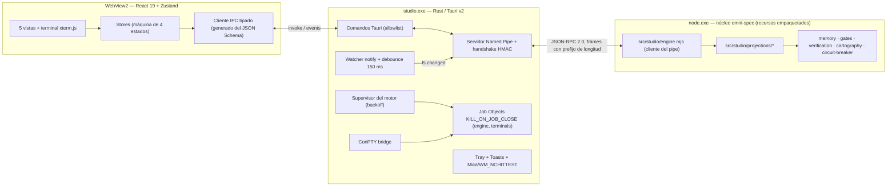

# Fase 4 — Plan de Tests (TDD)

**Alcance:** Omni Studio Desktop para Windows 11.
- Host nativo Tauri v2 (Rust).
- Motor Node.js conectado por Named Pipe y confinado en un Job Object.
- File watcher con debounce, terminal ConPTY, bandeja del sistema y ventana Mica con Snap Layouts.
- Frontend React 19 / TypeScript / Tailwind v4 / Zustand con las 5 vistas y la regla de los 4 estados.
- Empaquetado NSIS con menú contextual del Explorador.

**Referencias:** `OMNI-NEXTGEN-BLUEPRINT.md` §3, §4.5, §4.6, §4.7, §4.8, §5 (Fase 4), §6 · `STUDIO-DESIGN-SYSTEM.md` (vinculante para toda la UI) · `NEXTGEN-PHASE3-TEST-PLAN.md` §9 (mediciones aceptadas).

**Revisión 2 (2026-11-05):** el mantenedor aprobó el plan y adoptó `STUDIO-DESIGN-SYSTEM.md`:
- Ventana de 3 columnas: rail, escenario e Inspector colapsable.
- Dock flotante.
- Componentes shadcn/ui.
- Calibración física de Better UI.
- Paleta Obsidian.

La conciliación está en §1.17. Los bloques nuevos o modificados son SH, DS, PJ-FIL, RP, EG-08, WN-02, WN-03, ST-08 y TR-01.

**Runners:**

| Capa | Runner | Dónde corre |
| :-- | :-- | :-- |
| Núcleo Node (`src/studio/`) | `node --test` (suite existente, cero dependencias) | Windows y Linux (en Linux el pipe se sustituye por un socket Unix) |
| Host Rust (`apps/studio/src-tauri`) | `cargo test` | Windows (los tests Win32 llevan `#[cfg(windows)]`) |
| Frontend (`apps/studio/src`) | Vitest + Testing Library + happy-dom | Windows y Linux |
| E2E | Playwright conectado por CDP al WebView2 de un build *debug* | Windows |

**Rama:** `feat/nextgen-phase4-omni-studio`.
**Regla de oro:** cada test se escribe y se ve fallar (rojo) antes del código que lo pone en verde. La suite existente sigue en verde en cada commit.

---

## 0. Criterio de aceptación (EARS) y trazabilidad

> **AC-F4:** Cuando el usuario inicie Omni Studio en Windows 11, la interfaz gráfica cargará el estado completo del proyecto en menos de 500 ms con un consumo de memoria inferior a 50 MB en reposo.

La definición medible de "estado completo", "500 ms" y "50 MB" está en D-5. El hallazgo §1.2 explica por qué hace falta.

| Riesgo o requisito (blueprint) | Bloque de tests |
| :-- | :-- |
| §6 Procesos huérfanos de Node al cerrar la app | JB, EG-06, CP-07, E2E-07, E2E-08 |
| §6 DNS rebinding y colisión de puertos | PP, SEC-03 |
| §4.7.1 Watcher `ReadDirectoryChangesW` con debounce de 150 ms | FW, EN-14, E2E-03 |
| §4.7.1 Terminal ConPTY con TrueColor | CP, VT, E2E-06 |
| §4.7.1 Bandeja con 4 estados y notificaciones | TR |
| §4.7.1 Mica y Snap Layouts (`WM_NCHITTEST`) | WN |
| §4.7.1 Menú contextual del Explorador (NSIS, `HKCU`) | PK-02, SEC-05, E2E-11 |
| §4.7.2 Vista 1: Kanban adaptativo por ceremonia | PJ-BRD, VB |
| §4.7.2 Vista 2: Cartografía y heatmap de Blast Radius | PJ-GRF, VC |
| §4.7.2 Vista 3: Diff virtualizado, cherry-picking y correcciones en línea | RV, VD, E2E-04, E2E-05 |
| §4.7.2 Vista 4: FinOps y Circuit Breaker | PJ-FIN, VF |
| §4.7.2 Vista 5: Skill Hub y peso de contexto | PJ-SKL, VS |
| §4.7.3 Regla de los 4 estados | ST-01, FS, E2E-02, E2E-09 |
| §4.7 Estética anti-cliché | DS |
| AC-F4 (tiempo y memoria) | EN-10, EG-07, E2E-01, `bench:studio` |

---

## 1. Hallazgos del código, del entorno y del blueprint que condicionan el diseño

Revisé el blueprint, el código de las fases 1-3 y la máquina de desarrollo. Estos puntos cambian lo que hay que construir y probar.

### 1.1 Entorno de desarrollo

| Herramienta | Estado en esta máquina | Consecuencia |
| :-- | :-- | :-- |
| Node 24.22.1 / npm 11.19.1 | Instalado | OK |
| `rustc`, `cargo`, `rustup` | **No instalados** (tampoco en `~/.cargo/bin`) | Bloqueante para el host Tauri. Requiere aprobación para instalar (D-18) |
| Visual Studio Build Tools 2019 (VC x86/x64) | Instalado | Probablemente suficiente para el *toolchain* `x86_64-pc-windows-msvc`. Lo verificaré compilando, no lo supongo |
| WebView2 Runtime | 156.0.4314.58 | OK |
| PowerShell 7 (`pwsh`) | **No instalado**, solo Windows PowerShell 5.1 | La terminal necesita una cadena de resolución de shell (D-12). Los tests no pueden depender de `pwsh` |
| NSIS (`makensis`) | No instalado | El *bundler* de Tauri lo descarga solo. No hace falta instalarlo a mano |
| pnpm 11.8.0 | Instalado | No lo uso: el repo es npm (D-16) |

### 1.2 El criterio AC-F4 no se puede cumplir literalmente si se mide todo el árbol de procesos

- En la Fase 3 se midió la línea base de Node con `node:sqlite`: **58 MB de RSS** sin hacer nada (§9.1 del plan de Fase 3). El motor de Studio es ese mismo proceso, así que solo él ya supera los 50 MB.
- WebView2 abre como mínimo cuatro procesos: *browser*, *renderer*, *GPU* y *utility*. En una app Tauri típica suman entre 80 y 150 MB.
- El ejecutable Rust de Tauri, en cambio, suele quedarse en 10-25 MB de *private working set*.

Por eso propongo medir 50 MB sobre el proceso host y reportar el árbol completo como dato observado (D-5). Lo mismo pasa con los 500 ms: un arranque en frío de WebView2 cuesta 300-600 ms por sí solo, antes de que Node arranque y lance `git rev-parse` para el *fast-path*. La métrica debe distinguir arranque en frío y en caliente.

### 1.3 "Abrir con Omni Studio en < 500 ms con el árbol cartográfico inicializado" choca con la medición de la Fase 3

La indexación en frío de 500k LOC tardó **4,5 s** en esta máquina, y solo abrir 4.000 archivos bajo el filtro del antivirus cuesta ~2,6 s. **Diseño:**
- Studio pinta de inmediato el estado que ya existe en `memory.db`.
- La pasada incremental corre en segundo plano.
- Solo la vista de Cartografía muestra *Loading* mientras tanto.
- Un proyecto nunca indexado muestra *Empty* con la CTA `[Escanear Proyecto Brownfield]`.

### 1.4 No existe un runner de pipeline agéntico que emita tokens

- `src/circuit-breaker.mjs` guarda un *snapshot* por tarea en la tabla `circuit_breakers`.
- Ningún módulo llama a un LLM ni produce un flujo de tokens por segundo.

La vista FinOps no puede mostrar "velocidad de streaming" sin una fuente real, y no voy a inventar datos. **Diseño (D-7):**
- Una tabla de eventos de solo escritura, `token_usage_events`, que el *store* del breaker rellena dentro de la misma transacción `BEGIN IMMEDIATE` que ya usa `recordTokenUsage`.
- Studio calcula la tasa sobre esos eventos.

Cuando exista un runner, alimentará la misma tabla.

### 1.5 La "inyección de correcciones en línea" necesita ese mismo runner inexistente

**Diseño (D-8):** la observación escrita en el diff se persiste como `observation` de tipo `review-remark` en `memory.db`, ligada a spec, archivo y línea. Cualquier agente la recupera con la herramienta MCP `omni_search_context`, que ya existe. Es una inyección real y verificable, sin depender de un runner.

### 1.6 El Smart Skill Dispatcher y el sanitizador de §4.5 no están implementados

No existe normalización NFKC ni contenedor `<external_skill_guideline>` en `src/`. Hoy el catálogo real son los 9 skills `omni-*` de `skills/`. **Diseño (D-9):**
- El Skill Hub de Fase 4 lista los skills instalados y los `SKILL.md` del proyecto.
- Los activa o desactiva.
- Mide su peso con el estimador que ya usa `context-auditor.mjs` (`caracteres / 4`, etiquetado como estimación).
- La importación de skills de mercado con sanitización queda para la Fase 4b.

### 1.7 Asignar el proceso al Job Object después de crearlo deja una carrera

- Con `CreateProcess` seguido de `AssignProcessToJobObject`, el hijo puede lanzar nietos antes de entrar en el job. Esos nietos quedarían huérfanos.
- Windows 10+ admite `PROC_THREAD_ATTRIBUTE_JOB_LIST` en `STARTUPINFOEX`, que asigna el job **en el momento de la creación**.
- La misma lista de atributos admite `PROC_THREAD_ATTRIBUTE_PSEUDOCONSOLE`, que es la que exige ConPTY.

Por eso propongo implementar el *spawn* directamente con el crate `windows` (D-3). `portable-pty` construye su propia lista de atributos y no permite añadir el job.

### 1.8 Un nombre de pipe aleatorio no basta contra la suplantación (*pipe squatting*)

Un proceso del mismo usuario puede crear el pipe antes que Studio o conectarse a él. Hacen falta cuatro defensas a la vez (D-1):
1. Crear el pipe con `FILE_FLAG_FIRST_PIPE_INSTANCE` (falla si ya existe).
2. Rechazar clientes remotos con `PIPE_REJECT_REMOTE_CLIENTS`.
3. Una DACL que solo concede acceso al SID del usuario actual.
4. Comprobar `GetNamedPipeClientProcessId` contra el PID del motor lanzado, más un *handshake* HMAC mutuo con un secreto que viaja por `stdin`, nunca por `argv` ni por variables de entorno.

### 1.9 `ClosePseudoConsole` puede bloquearse

Si nadie vacía el pipe de salida, la llamada puede bloquearse indefinidamente. El lector de salida debe vivir en un hilo propio y seguir leyendo hasta EOF mientras se cierra la consola (CP-08).

### 1.10 El watcher puede entrar en bucle consigo mismo

El motor escribe en `specs/.omni/memory.db`, `-wal` y `-shm` cada vez que reindexa. Si el watcher no excluye esas rutas, cada reindexación dispara otra. Además, `.git/` cambia constantemente: solo interesan `.git/HEAD` y `.git/index`, que sirven para refrescar el diff (FW-04).

### 1.11 No sé si `@git-diff-view/react` virtualiza filas

No he podido comprobar que el componente React virtualice filas por sí mismo. El requisito es "O(1) en DOM con 10.000 líneas a 60 FPS". El primer test de la vista (VD-01) es una prueba de concepto que cuenta nodos DOM. Si falla, renderizo con el modelo `DiffFile` de `@git-diff-view/core` y `@tanstack/react-virtual` (D-6).

### 1.12 El repo es un paquete npm sin dependencias de runtime

- `package.json#files` es una lista blanca que ya excluye `apps/`.
- Biome solo incluye globs explícitos.

`apps/studio` debe quedar aislado: su propio `package.json` y su propio lockfile, sin ser *workspace* de la raíz. Así `npm ci` en la raíz y el tarball publicado no cambian (PKG-01, PKG-02).

Una consecuencia útil: el núcleo de `omni-spec` (`src/` + `bin/`) es JavaScript puro sin dependencias. Se puede empaquetar como recurso de Tauri y Studio ejecuta exactamente la versión con la que se compiló (D-4).

### 1.13 El tablero no puede permitir arrastrar tarjetas entre carriles

El carril de una spec se deriva de evidencia:
- la ruta de `fit` (`light`, `standard`, `full`);
- `tasks.json`;
- el registro de verificación firmado con HMAC;
- las aprobaciones de compuerta (`gates.mjs`).

Arrastrar una tarjeta a "Verificado" sería falsificar el estado. **El tablero es una proyección de solo lectura** y las transiciones son acciones explícitas, como "Aprobar Compuerta 1", que el motor valida (D-11).

### 1.14 La función de proyección del tablero va en el núcleo Node, no en React

El mapeo de estado a carril es lógica de dominio. Vive en `src/studio/projections/board.mjs`, se prueba con `node:test` en Linux y Windows, y React solo lo dibuja.

### 1.15 El filtro "desarrollador asignado" no tiene fuente de datos

Ni el manifiesto ni `tasks.json` tienen un campo de responsable. Hace falta un campo opcional y aditivo (D-13).

### 1.16 Snap Layouts se pierden con una barra de título propia

Con `decorations: false`, Windows 11 no muestra el *flyout* de Snap Layouts sobre el botón maximizar. Para recuperarlo hay que subclasificar la ventana (`SetWindowSubclass`) y responder a `WM_NCHITTEST` con `HTMAXBUTTON` sobre ese botón. La lógica de *hit-test* es una función pura (WN-01). El *flyout* real solo se puede verificar a mano (WN-04, evidencia manual).

### 1.17 Conciliación con `STUDIO-DESIGN-SYSTEM.md`

El documento se acata tal cual, salvo en estos puntos, donde aplicarlo al pie de la letra no funcionaría en Windows o mostraría datos que no existen:

1. **`titleBarStyle: 'overlay'` solo existe en macOS** en Tauri v2. En Windows la barra integrada se consigue con `decorations: false`, una barra propia y `WM_NCHITTEST` (§1.16, WN-01). El resultado visual es el que pide el documento: barra fundida con el cromo, *breadcrumb* y controles `- □ ✕`. El frontend comunica a Rust los rectángulos de los botones (SH-06).
2. **`future: { hoverOnlyWhenSupported: true }` es configuración de Tailwind v3.** En Tailwind v4, `hover:` ya se compila dentro de `@media (hover: hover)`. DS-10 verifica ese resultado en el CSS compilado, que es lo que pide la norma.
3. **El botón de shadcn/ui trae `transition-all` por defecto.** Se sobrescribe en `components/ui/button.tsx`. DS-09 prohíbe `transition-all` tanto en el código como en el CSS compilado.
4. **Valores hex inconsistentes dentro del documento:** §1 dice divisor `#262626` y borde del dock `#282a2c`; §2.1 dice `#262628` y `#2a2a2e`. Tomo **§2.1 (paleta canónica)** como fuente única de *tokens* (DS-04).
5. **Tema único Obsidian (oscuro).** El documento solo define la paleta oscura, así que la ventana fuerza el tema oscuro de DWM para que el tinte de Mica coincida. Eso sustituye el "respetar `AppsUseLightTheme`" del blueprint §4.7.1.5 (WN-03). Mica se ve en la barra de título y el *canvas* base usa `#121213` opaco: los contrastes de DS-06 se calculan sobre colores opacos.
6. **El dock envía instrucciones sin que exista un runner (§1.4).** Diseño (D-19): el dock compone `/omni-<modo> <instrucción>` y lo escribe en la **sesión de terminal ConPTY activa**, donde corre la CLI del agente del usuario (`claude`, `gemini`, `agy`…). Es el *passthrough* delegado de §4.8. Si no hay ninguna terminal abierta, el dock muestra el estado *Protected* con la explicación.
7. **Elementos de la maqueta sin fuente de datos real** (D-20): no se renderizan; los añadirá la fase que cree la fuente.
   - El conmutador "⚡ Turbo".
   - El selector de modelo.
   - El contador "Subagentes (3)".
   - El coste en dólares "$0.12": no hay tabla de precios fiable *offline*. FinOps muestra tokens y, solo con Ollama o LM Studio, "$0".
8. **Los emojis de la maqueta (📁 ⚡ 💰 🟢) se sustituyen por iconos Lucide** normalizados (`strokeWidth={1.75}`, 16/18 px), como manda §3.4 del propio documento (DS-12).
9. **Colores de la bandeja** (blueprint verde, azul, amarillo y rojo) → Emerald `#10b981`, Cyan `#06b6d4` con pulso, Amber `#f59e0b` y Crimson `#f43f5e` (TR-01).
10. **El rail lista varios proyectos.** Studio guarda los proyectos recientes en `%APPDATA%\OmniStudio\recent.json` (RP). Mantiene un motor por proyecto activo y cambiar de proyecto reinicia el motor con la nueva raíz (EG-08).

---

## 2. Arquitectura propuesta

- **El frontend nunca habla con el pipe.** Llama a comandos Tauri. Rust solo reenvía los métodos de una lista blanca (SEC-02).
- **El protocolo tiene una sola fuente de verdad:** el registro `STUDIO_METHODS` en `src/studio/protocol.mjs`. Un script genera `schema/studio-ipc.schema.json` a partir de él, y de ese esquema salen los tipos TypeScript del frontend. Rust comprueba la conformidad con vectores dorados (PP-07).
- **Archivos nuevos en el núcleo:**
  - `src/studio/protocol.mjs`
  - `src/studio/engine.mjs`
  - `src/studio/review.mjs`
  - `src/studio/projections/{board,graph,finops,skills}.mjs`
  - comando oculto `omni-spec studio-engine --pipe <name>`
- **Archivos nuevos en la app:**
  - `apps/studio/src-tauri/src/{win32/job.rs, win32/spawn.rs, pipe.rs, engine.rs, pty.rs, watcher.rs, tray.rs, window.rs, commands.rs}`
  - `apps/studio/src/{ipc,stores,views,components,design}/`

Etiquetas usadas en las tablas:

| Etiqueta | Significado |
| :-- | :-- |
| **[win32]** | Solo Windows (`skip` o `#[cfg(windows)]` en otras plataformas) |
| **[perf]** | Suelo conservador en la suite; el objetivo EARS se mide en `npm run bench:studio` (D-5) |
| **[fs]** | Repositorio git de prueba en `mkdtemp` |
| **[manual]** | Evidencia manual con captura y checklist; no automatizable de forma fiable |
| **[slow]** | Solo en CI o bajo demanda (`npm run test:studio:e2e`, `test:studio:package`) |

---

## 3. Inventario de archivos

| Archivo | Runner | Tests |
| :-- | :-- | --: |
| `test/studio-protocol.test.mjs` | node:test | 16 |
| `test/studio-engine.test.mjs` | node:test | 17 |
| `test/studio-projections.test.mjs` | node:test | 37 |
| `test/studio-review.test.mjs` | node:test | 15 |
| `test/memory.test.mjs` (migración v4) | node:test | 4 (+4 de `cartography-graph.test.mjs` desacoplados de la versión 3) |
| `test/studio-cli.test.mjs` (CLI-S y PKG) | node:test | 5 |
| **Subtotal núcleo Node** | | **94** |
| `apps/studio/src-tauri/src/**` (`#[cfg(test)]`) y `tests/*.rs` | cargo test | **62** |
| `apps/studio/src/**/*.test.ts(x)` | Vitest | **97** |
| `apps/studio/e2e/*.spec.ts` **[win32] [slow]** | Playwright (CDP) | **11** |
| `apps/studio/tests/packaging.test.ts` **[win32] [slow]** | Vitest | **7** |
| **Total Fase 4** | | **271** |

Soporte de pruebas:
- `test-support/studio-host.mjs`: simula el host Rust como servidor del pipe, para probar el motor sin Tauri.
- `test-support/studio-fixtures.mjs`: proyectos git de prueba, construidos en código.
- `apps/studio/protocol-vectors.json`: vectores dorados de *frames*, generados por el codificador Node.

---

## 4. Protocolo IPC — `src/studio/protocol.mjs` (`test/studio-protocol.test.mjs`)

**API propuesta:**
- `STUDIO_PROTOCOL_VERSION = 1`.
- `encodeFrame(message)` → `Buffer` con una cabecera `uint32` *little-endian* que da la longitud en bytes, seguida del JSON en UTF-8.
- `createFrameDecoder({ maxFrameBytes = 8 MiB })` → `{ push(chunk): message[] }`.
- `STUDIO_METHODS`: registro congelado `{ name: { direction, paramsSchema, resultSchema } }`.
- `handleRpc(message, handlers)`.

| ID | Caso | Esperado |
| :-- | :-- | :-- |
| PR-01 | Ida y vuelta con ASCII, CJK y emoji | La cabecera cuenta **bytes**, no caracteres |
| PR-02 | Un *frame* entregado de 1 en 1 byte | Un solo mensaje, idéntico |
| PR-03 | Tres *frames* en un único *chunk* | Tres mensajes en orden |
| PR-04 | Cabecera partida (2 + 2 bytes) | Decodificado correcto |
| PR-05 | Cabecera que anuncia más de `maxFrameBytes` | `FrameTooLargeError` **antes** de reservar el *payload*. El decodificador queda inutilizado (no intenta resincronizar) y la conexión se cierra |
| PR-06 | *Frame* de longitud 0 | Error de protocolo |
| PR-07 | UTF-8 inválido | Error (`TextDecoder` con `fatal: true`) |
| PR-08 | JSON inválido | Respuesta JSON-RPC `-32700` con `id: null` |
| PR-09 | Falta `jsonrpc: "2.0"` o `method` | `-32600` |
| PR-10 | Método desconocido | `-32601` |
| PR-11 | Parámetros que violan el esquema | `-32602` con la ruta del problema |
| PR-12 | Notificación (sin `id`) | Sin respuesta |
| PR-13 | Lotes (*batch*) en array | `-32600` (no se admiten, documentado) |
| PR-14 | `id` duplicado mientras el anterior sigue en vuelo | `-32600` |
| PR-15 | `STUDIO_METHODS` congelado; cada entrada tiene `direction`, `paramsSchema` y `resultSchema` | Mutar lanza en modo estricto |
| PR-16 | **Deriva del esquema:** `schema/studio-ipc.schema.json` comparado con el que genera el registro | Idénticos; si no, el test indica `npm run build:studio-schema` |

Métodos de la v1:
- Del host al motor: `studio.challenge`, `studio.hello`, `project.snapshot`, `board.get`, `cartography.graph`, `blastRadius.heat`, `diff.get`, `diff.getFile`, `review.decideHunk`, `review.stageApproved`, `review.addRemark`, `gate.approve`, `finops.snapshot`, `skills.list`, `skills.toggle`, `files.tree`, `fs.changed`, `fs.rescan`.
- Del motor al host: `project.changed`, `finops.tick`.

---

## 5. Motor Node — `src/studio/engine.mjs` (`test/studio-engine.test.mjs`) **[fs]**

**API:** `runStudioEngine({ root, pipePath, secret, version })`.

En el CLI, `omni-spec studio-engine --pipe <path>` lee el secreto (64 caracteres hex) de la **primera línea de `stdin`**.

**Handshake** (`handshakeProof(secret, role, nonce) = HMAC-SHA256(secret, "omnispec-studio-v1:" ‖ role ‖ ":" ‖ nonce)`):
1. El host envía la petición `studio.challenge { protocolVersion, nonce }`.
2. El motor responde `{ protocolVersion, proof: handshakeProof(secret, "engine", nonce), nonce: nonceEngine, pid, versions }`.
3. El host envía la notificación `studio.hello { proof: handshakeProof(secret, "host", nonceEngine) }`. El motor no atiende ningún otro método hasta validarla.

El motor se ejecuta también en el propio proceso (`runStudioEngine` resuelve con el código de salida). Eso permite inyectar colaboradores en EN-13, EN-16 y EN-17.

| ID | Caso | Esperado |
| :-- | :-- | :-- |
| EN-01 | Handshake mutuo correcto | Sesión abierta; versiones de protocolo, motor y Node intercambiadas |
| EN-02 | Secreto incorrecto en cualquiera de los dos lados | Conexión cerrada, salida con código 3 `HANDSHAKE_FAILED`. **Ningún** dato del proyecto se envía antes del handshake |
| EN-03 | Petición antes del handshake | Conexión cerrada |
| EN-04 | `STUDIO_PROTOCOL_VERSION` distinta | Código 3 con mensaje explícito de ambas versiones |
| EN-05 | El secreto no viaja por `argv` ni por el entorno | `--secret` se rechaza; un test inspecciona `process.argv` del hijo |
| EN-06 | Secreto con formato inválido o `stdin` vacío | Código 2 |
| EN-07 **[win32]** | `--pipe` no cumple `^\\\\\.\\pipe\\omnispec-[0-9a-f-]{36}$` | Código 2 |
| EN-08 | El host cierra el pipe | El motor cierra `memory.db` con `wal_checkpoint(TRUNCATE)` y sale con código 0 en menos de 1 s |
| EN-09 | EOF en `stdin` (el padre murió) | Salida limpia. Complementa al Job Object en plataformas sin él |
| EN-10 **[perf]** | `project.snapshot` sobre el fixture | Devuelve `{ schemaVersion, root, branch, versions, activeSpec, specs[], routes, gates, breakers, cartography: { indexed, summary }, memory: { walBytes, specsTreeOid } }`. Suelo de la suite: < 150 ms tras el handshake |
| EN-11 | 20 peticiones concurrentes | Todas responden; se correlacionan por `id` aunque lleguen desordenadas |
| EN-12 | Error de dominio (`GATE_LOCKED`, `PATH_OUTSIDE_ROOT`, `HUNK_STALE`…) | Respuesta con `error.data = { code, detail, retryable }`, sin traza de pila. El motor sigue sirviendo |
| EN-13 | Error inesperado (un bug) | Escribe la traza completa en `stderr` y **termina** con código 70. El supervisor lo reinicia (D-12). Nada se traga |
| EN-14 | Lote `fs.changed` con fuentes modificadas | Una sola pasada incremental de cartografía y **una** notificación `project.changed { areas }` por lote |
| EN-15 | `fs.changed` sobre `specs/*.json` | `syncFromGit` rehidrata y emite `project.changed { areas: ['board'] }` |
| EN-16 | Ciclo de vida de la memoria | `openProjectMemory` se llama una sola vez y el *checkpoint supervisor* queda activo. Al salir se cierran ambos (spy) |
| EN-17 | Contrapresión: 10.000 notificaciones con el lector del host en pausa | El motor espera a `drain`. El heap retenido crece menos de 8 MB (sin buffer ilimitado) |

---

## 6. Proyecciones puras — `src/studio/projections/*` (`test/studio-projections.test.mjs`)

### 6.1 Tablero (PJ-BRD) — `board.mjs`

| ID | Caso | Esperado |
| :-- | :-- | :-- |
| PJ-BRD-01 | Carriles de la ruta `light` | `Backlog → En ejecución → Verificado` |
| PJ-BRD-02 | Carriles de la ruta `standard` | `Especificación → Tareas → Implementación → Verificación` |
| PJ-BRD-03 | Carriles de la ruta `full` | `Especificación → Revisión Blast Radius (Compuerta 1) → Tareas → Implementación → Verificación HMAC y Diff (Compuerta 2) → Cerrado` |
| PJ-BRD-04 | Tabla de colocación: para cada ruta, combinaciones de documento de spec, tareas (`pending`/`in_progress`/`done`), registro de verificación, aprobación de cada compuerta y `completed` | Carril exacto en cada fila de la tabla (test dirigido por datos) |
| PJ-BRD-05 | Spec sin ruta de `fit` | Carril aparte `Sin ruta`, con la acción `fit` sugerida. Nunca se le asigna `standard` en silencio |
| PJ-BRD-06 | Registro de verificación manipulado (firma HMAC inválida) | `attestation: 'invalid'`. La tarjeta no avanza más allá de la Compuerta 2 y la vista la muestra como *Protected* |
| PJ-BRD-07 | Contenido de la tarjeta | `id`, `title`, `route`, `tags`, `risk` (último informe de Blast Radius), `owner`, `tasks { done, total }`, `gates`, `attestation` |
| PJ-BRD-08 | Filtros por etiqueta, nivel de riesgo y responsable combinados | Se aplican como AND. Sin filtros se ve todo. Una etiqueta inexistente da un tablero vacío (no un error) |
| PJ-BRD-09 | Orden dentro de cada carril | Estable: `updatedAt` descendente y después `id` |
| PJ-BRD-10 | Campo `owner` (D-13): presente, ausente o inválido | Presente se proyecta; ausente da `null`; inválido es error de validación del manifiesto |

### 6.2 Grafo (PJ-GRF) — `graph.mjs`

| ID | Caso | Esperado |
| :-- | :-- | :-- |
| PJ-GRF-01 | Proyección de `modules_graph` + `module_dependencies` | Nodos `{ id:int, path, language, nodeType, dIn, dOut, contractLevel, isBarrel }` y aristas `{ s, t, type: 'value'\|'type_only'\|'synthetic' }` con identificadores enteros compactos |
| PJ-GRF-02 | Destinos `external` y `unresolved` | No generan aristas; se cuentan por nodo (`externalCount`, `unresolvedCount`) |
| PJ-GRF-03 | Determinismo | Salida idéntica byte a byte en dos ejecuciones |
| PJ-GRF-04 **[perf]** | 4.000 nodos y 20.000 aristas | *Payload* < 2 MB y proyección en < 150 ms |
| PJ-GRF-05 | `blastRadius.heat { target, symbols? }` | Por cada nodo impactado, `{ distance, score, edgeClass }`, reutilizando `evaluateBlastRadius`. Los nodos no impactados no aparecen |
| PJ-GRF-06 | Barreras de contrato y barrels | `contractLevel > 0` marcado; las rutas que pasan por un barrel desenrollado llevan `viaBarrel` |
| PJ-GRF-07 | Índice vacío | `{ indexed: false, nodes: [] }`; la vista lo muestra como *Empty* |
| PJ-GRF-08 | Ciclos | Lista de `findCycles` incluida, con un máximo de 100 y `truncated` |

### 6.3 FinOps (PJ-FIN) — `finops.mjs` + `circuit-breaker.mjs`

| ID | Caso | Esperado |
| :-- | :-- | :-- |
| PJ-FIN-01 | `recordTokenUsage` desde el *store* del breaker | Inserta en `token_usage_events` dentro de la **misma** transacción `BEGIN IMMEDIATE` que el *snapshot*. Si se fuerza un fallo, no queda ninguno de los dos |
| PJ-FIN-02 | Tasa en tokens/s sobre una ventana deslizante de 10 s | Valor exacto en una línea temporal fija (reloj inyectado) |
| PJ-FIN-03 | Consumo acumulado de la sesión | Exacto |
| PJ-FIN-04 | Presupuesto restante y holgura de tasa | `80.000 − usados` y `25.000/min − ventana`, con los valores de `BREAKER_DEFAULTS` (no copiados a mano) |
| PJ-FIN-05 | Estado del breaker por tarea | `CLOSED`, `HALF_OPEN`, `OPEN` o `DEAD_LETTER`, con el motivo si está `OPEN` |
| PJ-FIN-06 | Fuente de credenciales | Etiqueta según `selectCredentialSource`: `passthrough`, `byok` o `local` (coste $0) |
| PJ-FIN-07 | Redacción | El JSON del *payload* no contiene ningún secreto del fixture (se comprueba con `redactSecrets` y búsqueda literal) |
| PJ-FIN-08 | Sin eventos | `{ stream: 'idle', tokensPerSecond: 0 }` explícito, nunca `null` |
| PJ-FIN-09 | Retención (D-7) | Al arrancar el motor se purgan los eventos de más de 30 días; los recientes quedan intactos |

### 6.4 Skills (PJ-SKL) — `skills.mjs`

| ID | Caso | Esperado |
| :-- | :-- | :-- |
| PJ-SKL-01 | Catálogo propio | Los 9 `omni-*` de `skills/`, con la descripción del *frontmatter* de cada `SKILL.md` |
| PJ-SKL-02 | Skills del proyecto | Descubiertas en los directorios de host que ya conoce `integrations.mjs`. Se marca el origen (`bundled` o `project`) |
| PJ-SKL-03 | Peso estimado | Usa `estimateTokens()`, extraído de `context-auditor.mjs` sin cambiar su resultado. Lleva la etiqueta `estimated: true` |
| PJ-SKL-04 | Peso total activo y porcentaje del presupuesto | Porcentaje sobre `studio.contextBudgetTokens` del manifiesto (D-9) |
| PJ-SKL-05 | `skills.toggle` | Persiste en `manifest.json#studio.skills.disabled` mediante escritura atómica. Es idempotente |
| PJ-SKL-06 | `SKILL.md` sin *frontmatter* | Se lista con `problem: 'FRONTMATTER_MISSING'`; no se oculta |
| PJ-SKL-07 | Activar o desactivar un skill inexistente | Error `SKILL_NOT_FOUND` |

### 6.5 Árbol de archivos (PJ-FIL) — `files.mjs` (pestaña *Files* del Inspector)

| ID | Caso | Esperado |
| :-- | :-- | :-- |
| PJ-FIL-01 | `files.tree` | Reutiliza `listProjectFiles`: respeta `.gitignore` y las exclusiones por defecto, devuelve rutas POSIX relativas y ordena directorios primero y después alfabéticamente |
| PJ-FIL-02 | Estado de Git por archivo | `modified`, `added`, `untracked` o `renamed`, según `git status --porcelain=v2 -z` sin shell |
| PJ-FIL-03 | Ruta solicitada fuera de la raíz (`files.tree { under }`) | `PATH_OUTSIDE_ROOT` |

---

## 7. Revisor y diff — `src/studio/review.mjs` (`test/studio-review.test.mjs`) **[fs]**

| ID | Caso | Esperado |
| :-- | :-- | :-- |
| RV-01 | `diff.get` | Ejecuta `git diff --no-color --no-ext-diff -M -U3` con `spawn` sin shell. Devuelve texto unificado y estadísticas por archivo; los binarios quedan marcados |
| RV-02 | Archivos sin seguimiento | Incluidos como adiciones mediante un diff sintético. **No se toca el índice** (sin `git add -N`) |
| RV-03 | Renombrado con cambios | Un solo archivo con `oldPath` y `newPath` |
| RV-04 | Archivo con CRLF | El texto del hunk conserva `\r` y el parche resultante se aplica |
| RV-05 | `hunkId` | Estable: `sha256(path ‖ cabecera ‖ contenido)`. Igual entre refrescos si el hunk no cambia |
| RV-06 | `review.decideHunk { hunkId, decision }` | Persiste en `review_decisions` (spec, hunk, decisión, actor y fecha) |
| RV-07 | `hunkId` obsoleto porque el árbol de trabajo cambió | Error `HUNK_STALE` |
| RV-08 | `review.stageApproved` | El índice contiene **exactamente** los hunks aprobados (`git diff --cached`). El árbol de trabajo queda idéntico byte a byte |
| RV-09 | Hunks rechazados | Siguen en el árbol de trabajo. **Nunca se revierten** (D-10) |
| RV-10 | Quedan hunks sin decidir | `stageApproved` responde `REVIEW_INCOMPLETE` |
| RV-11 | `gate.approve` de la Compuerta 2 | Solo procede si todos los hunks están decididos **y** la verificación está atestada y es válida. Si no, `GATE_LOCKED` con el motivo exacto, que la vista *Protected* muestra literalmente |
| RV-12 | `review.addRemark { file, line, side, text }` | Se guarda como observación `review-remark` y **es recuperable con `omni_search_context` por MCP** (test de integración) |
| RV-13 | Texto de la observación vacío o de más de 2.000 caracteres | Error de validación |
| RV-14 | Ruta fuera de la raíz | `PATH_OUTSIDE_ROOT`; no se lee nada |
| RV-15 **[perf]** | Diff de 10.000 líneas | `diff.get` en < 500 ms. Si el total supera 8 MiB, se devuelve solo la lista de archivos y cada uno se pide con `diff.getFile` |

---

## 8. Esquema de memoria v4 (`test/memory.test.mjs`)

| ID | Caso | Esperado |
| :-- | :-- | :-- |
| MEM-01 | Base nueva | `user_version = 4`. Existen `token_usage_events (id, task_id, tokens, source, provider, recorded_at_ms)` con índice `idx_token_events_task_time`, y `review_decisions (spec_id, hunk_id, decision, actor, decided_at)` con PK `(spec_id, hunk_id)`. El `CHECK` de `observations.category` admite `review-remark` (la v3 solo admitía `pattern`, `gotcha`, `convention` y `constraint`: la tabla se reconstruye) |
| MEM-02 | Base v3 con datos (DDL congelado de `b3f038d` en `test-support/memory-legacy-schemas.mjs`) | Migra a v4 dentro de `BEGIN IMMEDIATE`. Conserva decisiones, observaciones y grafo; la búsqueda FTS sigue encontrando las observaciones |
| MEM-03 | Dos procesos abren la misma base v3 a la vez | Una sola migración |
| MEM-04 | `user_version = 5` | Error `Unsupported memory schema version` |

---

## 9. CLI y paquete npm

| ID | Caso | Esperado |
| :-- | :-- | :-- |
| CLI-S-01 | `--help` | `studio-engine` aparece en la sección de comandos internos |
| CLI-S-02 | `studio-engine` sin `--pipe` | Uso y código 2 |
| CLI-S-03 | Fuera de un proyecto OmniSpec | Código distinto de 0 con mensaje claro |
| PKG-01 | `npm pack` | El tarball no contiene nada de `apps/` |
| PKG-02 | `package.json` raíz | Sigue sin `dependencies` de runtime |

---

## 10. Host Rust — `apps/studio/src-tauri` (`cargo test`)

Regla de código:
- Las funciones de biblioteca devuelven `Result<_, StudioError>`, con el código Win32 de `GetLastError` cuando aplica.
- No hay `unwrap()` ni `expect()` fuera de los tests. `clippy -D warnings` lo vigila (`clippy::unwrap_used`).

**API pública del crate `omni_studio`.** Los tests de integración viven en `src-tauri/tests/*.rs` y solo usan esta API:

| Módulo | Superficie |
| :-- | :-- |
| `error` | `StudioError` (`thiserror`): `Win32 { op, code }`, `PipeSquatted`, `PeerRejected { pid }`, `HandshakeFailed`, `FrameTooLarge { len, max }`, `NodeUnsupported { found }`, `NodeNotFound`, `EngineDead`, `EngineTimeout { method }`, `ShellNotFound { shell }`, `MethodNotAllowed { method }`, `RecentUnreadable`, `ProjectInvalid` |
| `win32::job` | `Job::kill_on_close() -> Result<Job>`, `job.limit_flags()`, `job.contains(pid)` |
| `win32::spawn` | `SpawnSpec { program, args, cwd, env, stdin, pseudoconsole }`, `spawn_in_job(&job, spec) -> Result<ChildProcess>`; `ChildProcess { pid(), wait(timeout), kill() }` |
| `protocol` | `encode_frame`, `FrameDecoder::new(max).push(&[u8])`, `MAX_FRAME_BYTES`, `handshake_proof(secret_hex, role, nonce_hex)` |
| `pipe` | `new_pipe_name()`, `is_valid_pipe_name()`, `PipeServer::create(name)`, `server.options()`, `server.dacl_sids()`, `server.accept(expected_pid, secret)` |
| `engine` | `NodeVersion::parse`, `resolve_node(env, path_lookup)`, `engine_entry(resources)`, `Backoff`, `Supervisor` |
| `pty` | `resolve_shell(preference, lookup)`, `Pty::open(PtyConfig) -> Result<Pty>`, `pty.write`, `pty.resize`, `pty.close`, `OutputBatcher` |
| `watcher` | `Debouncer::new(quiet, max_wait)` con `Instant` inyectado, `PathFilter::new(root)`, `normalize(root, path)`, `WatchEvent::{Batch, Rescan, RootLost}` |
| `window` | `hit_test(point, &CaptionLayout, dpi) -> HitRegion`, `mica_supported(build)`, `force_dark(hwnd)` |
| `tray` | `TrayInputs`, `tray_state(&TrayInputs) -> TrayState`, `TrayState::color_hex()`, `ToastPolicy` |
| `security` | `ALLOWED_ENGINE_METHODS`, `is_method_allowed(method)` |
| `recent` | `RecentProjects::load(path)`, `recent.open(path)`, `recent.entries()` |

### 10.1 Job Objects y spawn atómico (JB) **[win32]**

| ID | Caso | Esperado |
| :-- | :-- | :-- |
| JB-01 | Crear job | `QueryInformationJobObject` confirma `JOB_OBJECT_LIMIT_KILL_ON_JOB_CLOSE` y la ausencia de `BREAKAWAY_OK` |
| JB-02 | `spawn_in_job` con `PROC_THREAD_ATTRIBUTE_JOB_LIST` | `IsProcessInJob(child, job) == true` justo al volver `CreateProcessW`, sin suspender ni reanudar el hilo |
| JB-03 | Nieto (un helper de test lanza un hijo e imprime su PID) | También está en el job |
| JB-04 | Se cierra el *handle* del job | Hijo y nieto terminan en menos de 2 s (`WaitForSingleObject`) |
| JB-05 | Muerte abrupta del host (`TerminateProcess` sobre un host helper) | Todos los descendientes mueren: es el escenario real de huérfanos de §6 |
| JB-06 | Un hijo intenta `CREATE_BREAKAWAY_FROM_JOB` | `ERROR_ACCESS_DENIED` |
| JB-07 | Error Win32 forzado (ejecutable inexistente) | `StudioError::Win32 { code: 2, op: "CreateProcessW" }`, sin pánico |

### 10.2 Named Pipe (PP) **[win32]**

| ID | Caso | Esperado |
| :-- | :-- | :-- |
| PP-01 | Nombre del pipe | `\\.\pipe\omnispec-{uuidv4}` con CSPRNG del SO. 1.000 nombres únicos que validan el patrón de EN-07 |
| PP-02 | Ya existe un pipe con ese nombre (*squatting*) | La creación falla con `PIPE_SQUATTED`. **No hay** reintento con otro nombre que oculte el ataque |
| PP-03 | Opciones del servidor | `first_pipe_instance(true)`, `reject_remote_clients(true)`, `max_instances(1)` |
| PP-04 | DACL | `GetSecurityInfo` muestra un único ACE de acceso para el SID del usuario actual |
| PP-05 | Conexión desde un PID distinto al del motor lanzado | Desconexión y evento `PEER_REJECTED`; no se envía ningún *frame* |
| PP-06 | Prueba HMAC incorrecta en el handshake | Desconexión. Usa la misma verificación en tiempo constante que `signaturesMatch` |
| PP-07 | **Conformidad entre lenguajes** con `protocol-vectors.json` (generado por `encodeFrame`) | El codificador y el decodificador Rust producen y aceptan exactamente los mismos bytes |
| PP-08 | Cabecera > 8 MiB | Rechazo antes de reservar memoria |
| PP-09 | Segundo cliente | Rechazado |
| PP-10 | Timeout por método (10 s por defecto, configurable) | El frontend recibe `ENGINE_TIMEOUT`; el motor no se mata por un timeout de lectura |

### 10.3 Supervisor del motor (EG)

| ID | Caso | Esperado |
| :-- | :-- | :-- |
| EG-01 | Resolución de Node | Primero `OMNI_STUDIO_NODE`, después `node.exe` en `PATH`. Exige `>= 22.19.0` según `node --version`. Si es menor: `NODE_UNSUPPORTED { found }` (vista de error con instrucción) |
| EG-02 | Entrada del motor | `resources/omni-spec/bin/omni-spec.mjs` empaquetado. Su versión coincide con la de la app (D-4) |
| EG-03 | Secreto | Se escribe en `stdin` del hijo, que queda abierto (su EOF señala la muerte del host) |
| EG-04 | Caídas repetidas | Reinicio con *backoff* 250 ms·2ⁿ, máximo 3 en 60 s. Después, estado `ENGINE_DEAD` sin bucle infinito |
| EG-05 | `stderr` del motor | Búfer circular de 256 KB, expuesto en el detalle colapsable de la vista *Error* |
| EG-06 | Cierre ordenado | Se cierra el pipe y el motor sale con 0 en menos de 1 s. Si no sale, el cierre del job lo mata (verificado) |
| EG-07 **[perf]** | Desde el *spawn* hasta el handshake completo | Suelo < 1.500 ms en la suite; objetivo < 300 ms en el *bench* |
| EG-08 | Cambio de proyecto | El motor anterior se cierra (EG-06) y se lanza uno nuevo con la nueva raíz y un pipe y secreto **nuevos**. Las peticiones en vuelo del anterior terminan con `PROJECT_SWITCHED` |

### 10.4 ConPTY (CP) **[win32]**

| ID | Caso | Esperado |
| :-- | :-- | :-- |
| CP-01 | `CreatePseudoConsole` de 120×30 y `cmd.exe /d /c echo OMNI` | La salida contiene `OMNI` |
| CP-02 | Resolución de shell (D-12) | `pwsh.exe` → `powershell.exe` → `cmd.exe` con `PATH` controlado. Se respeta un *override* configurado; si el configurado no existe, error explícito (sin caer a otro en silencio) |
| CP-03 | Ida y vuelta de entrada | `cd` + Enter devuelve la raíz del proyecto como directorio de trabajo |
| CP-04 | `ResizePseudoConsole` | `mode con` informa del nuevo tamaño |
| CP-05 | TrueColor `\x1b[38;2;1;2;3m` | Llega intacto |
| CP-06 | UTF-8 (`chcp 65001`) | `echo ñ✓` devuelve los mismos bytes |
| CP-07 | La shell está en el job `terminals` | `IsProcessInJob == true` |
| CP-08 | Cierre | `ClosePseudoConsole` con el lector drenando en su propio hilo vuelve en menos de 2 s (sin el bloqueo de §1.9) y la shell termina |
| CP-09 | Inundación de salida: `for /L %i in (1,1,100000) do @echo %i` | Eventos agrupados cada ≤ 16 ms o ≤ 64 KB, canal acotado con contrapresión y memoria del host < +20 MB |
| CP-10 | Varias terminales | Identificadores independientes; cerrar una no afecta a las demás |
| CP-11 | Salida de la shell | Se informa el código de salida |

### 10.5 File watcher (FW)

| ID | Caso | Esperado |
| :-- | :-- | :-- |
| FW-01 | 50 escrituras en 100 ms (reloj de tokio pausado) | Un lote, emitido 150 ms después de la última |
| FW-02 | Cambios continuos durante 5 s | Espera máxima de 1 s: se emite al menos un lote por segundo (sin inanición) |
| FW-03 | Deduplicación | Rutas únicas en POSIX relativo |
| FW-04 | Exclusiones | Sin eventos para `specs/.omni/**` (incluidos `-wal` y `-shm`), `node_modules/**`, `target/**` y `.git/**`, salvo `.git/HEAD` y `.git/index` (anti-bucle, §1.10) |
| FW-05 | `.gitignore` | Respetado (crate `ignore`) |
| FW-06 **[win32]** | `ReadDirectoryChangesW` real (`notify`): crear, modificar, renombrar y borrar | Detectado de extremo a extremo en ≤ 450 ms |
| FW-07 | Desbordamiento del búfer del kernel (evento `Rescan`) | Emite `fs.rescan` (refresco completo). Ningún evento se pierde en silencio |
| FW-08 | Se borra o renombra la raíz vigilada | Estado de error del watcher, que la UI muestra con *Reintentar* |

### 10.6 Ventana (WN)

| ID | Caso | Esperado |
| :-- | :-- | :-- |
| WN-01 | `hit_test(point, layout, dpi)` (función pura) a 100 %, 150 % y 200 % | Botones → `HTMINBUTTON`, `HTMAXBUTTON` y `HTCLOSE`; barra → `HTCAPTION`; bordes → `HTTOP`, `HTLEFT`… |
| WN-02 | Efecto Mica | Se aplica en build ≥ 22000. En builds anteriores, color sólido `#121213`, decidido por consulta explícita de la versión (no por `try/catch`) |
| WN-03 | Tema DWM (§1.17.5) | La ventana fuerza `DWMWA_USE_IMMERSIVE_DARK_MODE = 1` aunque `AppsUseLightTheme = 1`. Se verifica con `DwmGetWindowAttribute` |
| WN-04 **[manual]** | *Flyout* de Snap Layouts al pasar sobre maximizar | Captura y checklist en `docs/evidence/phase4/` |

### 10.7 Bandeja y notificaciones (TR)

| ID | Caso | Esperado |
| :-- | :-- | :-- |
| TR-01 | `tray_state(inputs)` (tabla) | Prioridad: Crimson `#f43f5e` (breaker `OPEN` o contrato violado) > Amber `#f59e0b` (compuerta en espera) > Cyan `#06b6d4` con pulso (motor ocupado) > Emerald `#10b981` |
| TR-02 | Iconos | 4 estados más los fotogramas del pulso azul, en ICO de 16, 20, 24, 32 y 48 px |
| TR-03 | Toasts | Al pasar a amarillo o rojo, y al terminar una tarea de más de 30 s. Sin duplicados por cada *tick* |
| TR-04 | Clic en el toast | Restaura y enfoca la ventana (callback con app simulada) |
| TR-05 | Cerrar a bandeja | Cerrar la ventana la oculta si el ajuste está activo. "Salir" desde la bandeja cierra la app y el job |

### 10.8 Seguridad y comandos (SEC)

| ID | Caso | Esperado |
| :-- | :-- | :-- |
| SEC-01 | `capabilities/*.json` | Solo los comandos propios. Ningún permiso de los plugins `fs`, `shell` ni `http` |
| SEC-02 | Lista blanca de métodos | Un método desconocido se rechaza en Rust sin llegar al motor |
| SEC-03 | CSP de `tauri.conf.json` | `default-src 'self'`; sin `'unsafe-eval'` ni `'unsafe-inline'` para scripts; `connect-src` limitado a `ipc:` y `http://ipc.localhost`. Ningún servidor HTTP en *release* |
| SEC-04 | Build *release* | Sin *devtools* y sin puerto de depuración remota: el argumento de WebView2 solo existe bajo `cfg(debug_assertions)` |
| SEC-05 | Segunda instancia con una carpeta como argumento | Se reenvía a la instancia existente (`tauri-plugin-single-instance`), que abre ese proyecto |
| SEC-06 | Argumento de proyecto inexistente o que es un archivo | Vista de error; no hay pánico |

### 10.9 Proyectos recientes (RP)

| ID | Caso | Esperado |
| :-- | :-- | :-- |
| RP-01 | Abrir proyectos | `recent.json` en `%APPDATA%\OmniStudio` mediante escritura atómica (temporal + `rename`). Orden MRU, sin duplicados (rutas canónicas sin distinguir mayúsculas en Windows) y máximo 10 |
| RP-02 | Proyecto reciente que ya no existe | Se devuelve con `missing: true`; no se borra en silencio |
| RP-03 | `recent.json` corrupto | Error tipado `RECENT_UNREADABLE`, visible en el rail. El archivo **no** se sobrescribe hasta que el usuario abre un proyecto |

**Subtotal Rust: 7 + 10 + 8 + 11 + 8 + 4 + 5 + 6 + 3 = 62.**

---

## 11. Frontend — `apps/studio/src` (Vitest)

### 11.0 Estructura del frontend (contrato de los tests)

| Ruta | Responsabilidad |
| :-- | :-- |
| `src/ipc/transport.ts` | `StudioTransport { invoke(command, args), listen(event, handler) → unlisten }`. Implementación Tauri y *fake* de test (`src/test/fake-transport.ts`) |
| `src/ipc/generated.ts` | Tipos generados desde `schema/studio-ipc.schema.json` (`npm run gen:ipc`) |
| `src/ipc/client.ts` | `createStudioClient(transport)`: `call(method, params)`, `subscribe(event, handler)`, `StudioError` |
| `src/stores/resource.ts` | `createResourceStore(fetcher)`: máquina de los 4 estados |
| `src/stores/*.ts` | Stores Zustand por dominio (`board`, `review`, `finops`, `terminal`, `layout`, `skills`, `graph`, `files`) creados desde un cliente |
| `src/views/*View.tsx` | `BoardView`, `CartographyView`, `DiffView`, `FinopsView`, `SkillsView` |
| `src/views/cartography/*` | `renderer.ts`, `quadtree.ts`, `heat-scale.ts`, `layout.worker.ts` |
| `src/shell/*` | `AppShell`, `TitleBar`, `Rail`, `Stage`, `Inspector` |
| `src/components/ui/*` | shadcn/ui personalizados: `button`, `tabs`, `dialog`, `icon`, `status-pill`, `cockpit-input`, `inspector-drawer`, `command-palette`, `kanban-board`, `diff-viewer`, `view-state` |
| `src/terminal/xterm-adapter.ts` | Puente xterm.js ⇄ comandos `pty.*` |
| `src/design/tokens.css` y `tokens.ts` | *Tokens* de §2.1 (fuente única) y `contrast.ts` (WCAG) |
| `src/i18n/messages.es.ts` | Textos visibles en español |
| `src/test/render.tsx` | `renderWithStudio(ui, { transport })` |

### 11.1 Cliente IPC (IC)

| ID | Caso | Esperado |
| :-- | :-- | :-- |
| IC-01 | Tipos generados desde `schema/studio-ipc.schema.json` | El archivo generado coincide con el versionado (test de deriva) |
| IC-02 | Mapeo de errores | `error.data.code` → `StudioError { kind: 'error' \| 'protected', code, message, detail, retryable }`. `GATE_LOCKED` y `NODE_UNSUPPORTED` dan `protected` y `error` respectivamente |
| IC-03 | Suscripción a `project.changed` | Invalida las claves de *store* afectadas. Al desmontar se desuscribe (cero *listeners* colgados) |
| IC-04 | Dos lecturas idénticas en vuelo | Una sola invocación |

### 11.2 Stores (ST)

| ID | Caso | Esperado |
| :-- | :-- | :-- |
| ST-01 | Máquina de estados de recurso | `idle → loading → ready \| empty \| error \| protected`. Una transición ilegal **lanza** (fail-fast) |
| ST-02 | Reintento desde *error* | Solo se repite la petición fallida; el resto de la sesión queda intacta |
| ST-03 | Refresco tras `project.changed` | Los datos `ready` siguen visibles mientras se revalida (sin parpadeo a *loading*, CLS = 0) |
| ST-04 | Filtros del tablero | Persisten por proyecto en `localStorage` |
| ST-05 | Decisiones de hunks | El servidor manda: estado `pending` por hunk hasta la confirmación, sin actualizaciones optimistas |
| ST-06 | *Ticks* de FinOps a 20 Hz | La vista FinOps renderiza a ≤ 4 Hz y el tablero **no** se re-renderiza (contador de renders) |
| ST-07 | Terminales | Mapa de sesiones; cerrar una libera su suscripción |
| ST-08 | Layout | Inspector colapsado o expandido, pestaña activa del Inspector y pestaña central: persisten por usuario en `localStorage` |

### 11.3 Contrato de los 4 estados (FS): 5 vistas × 4 estados = 20 tests parametrizados

| Estado | Aserciones |
| :-- | :-- |
| Loading | El *skeleton* tiene `aria-busy="true"` y usa la **misma** plantilla de grid y los mismos *tokens* de alto de fila que la vista lista (igualdad estructural de atributos de layout). La medición real de CLS está en E2E-02 |
| Empty | CTAs concretas por vista. Tablero: `[Crear Hotfix Micro (--light)]`, `[Iniciar Nueva Especificación]`, `[Escanear Proyecto Brownfield]`. Cada clic despacha su acción |
| Error | Mensaje legible sin código opaco, `
` con el detalle técnico y `[Reintentar Operación]`, que llama a `retry()` de su *store* |
| Protected | Texto de gobernanza exacto del blueprint para la Compuerta 2, más el motivo concreto del motor. No se muestra ningún botón de aprobación |

### 11.4 Vistas

| ID | Caso | Esperado |
| :-- | :-- | :-- |
| VB-01 | Tablero con cada ruta | 3, 4 y 6 carriles |
| VB-02 | Tarjeta | Campos de PJ-BRD-07; los números en mono tabular |
| VB-03 | Barra de filtros | Etiqueta, riesgo y responsable; refleja PJ-BRD-08 |
| VB-04 | Teclado | Flechas para moverse entre tarjetas, Enter abre el detalle y Esc cierra |
| VB-05 | No hay *drag & drop* (D-11) | Ningún elemento `draggable` |
| VB-06 | Acción "Aprobar Compuerta 1" | Llama a `gate.approve`. Si llega `GATE_LOCKED`, la tarjeta muestra *Protected* inline |
| VB-07 | Carril con 500 tarjetas | Virtualizado: ≤ 60 tarjetas en el DOM |
| VC-01 | *Renderer* Canvas 2D con un contexto simulado | Dibuja N nodos y M aristas; conteo de llamadas exacto |
| VC-02 | *Culling* del viewport | Solo se dibuja lo visible |
| VC-03 | *Picking* por quadtree (función pura) | Nodo correcto bajo el puntero, también con zoom |
| VC-04 | Escala de calor | Monótona en luminancia y de un solo tono (no arcoíris). Contraste ≥ 3:1 frente al fondo |
| VC-05 | Estilo de aristas | `value` continua; `type_only` discontinua; `synthetic` punteada |
| VC-06 | Marcadores | Barrera de contrato y barrel visibles en la leyenda y en el nodo |
| VC-07 | Layout en Web Worker con semilla fija | Mismas posiciones en dos ejecuciones |
| VC-08 | Selección de nodo | Llama a `blastRadius.heat` y pinta el linaje por distancia (D-14) |
| VD-01 | **Prueba de concepto de virtualización (D-6):** diff de 10.000 líneas | ≤ 200 filas de código en el DOM (visibles + *overscan*) |
| VD-02 | Lado a lado o unificado | Cambio sin perder el scroll |
| VD-03 | Botones aprobar y rechazar por hunk, con atajos `a` / `r` | Llaman a `review.decideHunk` |
| VD-04 | Resumen de decisiones | `[Preparar hunks aprobados]` deshabilitado hasta decidir todos |
| VD-05 | Seleccionar una línea y escribir una corrección | Llama a `review.addRemark` con `file`, `line` y `side` |
| VD-06 | Corrección vacía o de más de 2.000 caracteres | Validación inline (igual que RV-13) |
| VD-07 | Compuerta 2 bloqueada | Banner *Protected* con el texto exacto |
| VD-08 | Archivo binario | Fila "binario, sin vista previa" |
| VD-09 | `project.changed` mientras se revisa | El diff se refresca. Las decisiones de hunks sin cambios se conservan; las de hunks modificados pasan a `HUNK_STALE` |
| VF-01 | Medidor de tokens/s | Valor y *sparkline* de 60 s |
| VF-02 | Barra de presupuesto del breaker | Usado y restante, con números exactos |
| VF-03 | Ventana de tasa (25k/min) | Holgura visible |
| VF-04 | Insignias de estado por tarea | 4 estados, con el motivo si está `OPEN` |
| VF-05 | Etiqueta de la fuente de credenciales | `Suscripción delegada`, `API Key (DPAPI)` u `Ollama local · $0` |
| VF-06 | Sin eventos | Estado *idle* explícito (no *Empty* con CTA) |
| VS-01 | Lista de skills | Nombre, origen y peso estimado; ordenable por peso |
| VS-02 | *Toggle* | Llama a `skills.toggle`; el estado viene del servidor |
| VS-03 | Total activo y porcentaje del presupuesto | Exacto |
| VS-04 | Fila con `problem` | Visible con su motivo |
| VS-05 | Presupuesto superado | Aviso inline, sin bloquear |
| VT-01 | Salida de la PTY | Se escribe en xterm |
| VT-02 | Entrada | Llama a `pty.write` |
| VT-03 | `ResizeObserver` | `pty.resize` con *debounce* |
| VT-04 | Desmontar | Cierra la PTY y libera el addon WebGL |

### 11.5 Shell de 3 columnas (SH) — `STUDIO-DESIGN-SYSTEM.md` §1, §2 y §4

| ID | Caso | Esperado |
| :-- | :-- | :-- |
| SH-01 | Estructura | Cuatro regiones con *landmarks*: `banner` (barra de título), `navigation` (rail), `main` (escenario) y `complementary` (Inspector). El dock flota sobre el escenario |
| SH-02 | Colapsar el Inspector (botón y `Ctrl+J`) | La columna del Inspector pasa a 0 y el escenario la ocupa. La transición solo se aplica con `motion-safe:`. El estado persiste (ST-08) |
| SH-03 | Pestañas del Inspector (`inspector-drawer`) | `Terminal`, `Overview`, `FinOps` y `Files`. Navegación con flechas (Radix Tabs) |
| SH-04 | Rail | Proyectos recientes (RP) con sus specs anidadas, CTA `+ Nueva Spec` y `Ajustes`. Seleccionar una spec enfoca su tarjeta en el tablero |
| SH-05 | Cambiar de proyecto desde el rail | Llama a `project.open`. Los *stores* se reinician y la vista pasa a *Loading* (EG-08) |
| SH-06 | Barra de título | *Breadcrumb* `Omni Studio / <proyecto> / branch: <rama>`, `data-tauri-drag-region` y controles `- □ ✕`. Al montar y al redimensionar se envían a Rust los rectángulos de los botones (`window.set_caption_layout`, entrada de WN-01) |
| SH-07 | Pestañas centrales | `Kanban`, `Cartografía`, `Diffs`, `FinOps` y `Skills`, con `Ctrl+1`…`Ctrl+5`. La pestaña activa persiste |
| SH-08 | Dock (`cockpit-input`) | `rounded-2xl`, fondo `#1e1e21` y borde de 1 px `#2a2a2e`, sin sombra. Selector de modo con los skills `omni-*` del catálogo. Enter envía `/omni-<modo> <texto>\r` a la terminal activa (`pty.write`, D-19); Shift+Enter inserta un salto de línea; con el texto vacío no se envía nada |
| SH-09 | Dock sin terminal activa | Estado *Protected*: «Abre una terminal con tu agente (claude, gemini, agy…) para enviar instrucciones», con un botón que abre la pestaña Terminal |
| SH-10 | Paleta de comandos (`command-palette`, `Ctrl+K`) | Diálogo modal (Radix Dialog) con búsqueda difusa sobre vistas, specs, archivos y acciones. Esc la cierra y el foco vuelve al elemento de origen |
| SH-11 | `status-pill` y pestaña *Overview* | Estado del breaker, tamaño del WAL (`0 B`, `12.4 KB`), Git Tree OID (7 caracteres) y tareas `done/total`, todo en mono. Sin subagentes ni coste en dólares (D-20) |
| SH-12 | Pestaña *Files* | Árbol de `files.tree` virtualizado, con `overscroll-contain` y marcas de estado Git. Un clic en un archivo modificado abre su diff |

### 11.6 Sistema de diseño (DS) — `STUDIO-DESIGN-SYSTEM.md` §1, §2.1 y §3

Todos los escaneos estáticos recorren `apps/studio/src/**` y el CSS compilado por Vite.

| ID | Caso | Esperado |
| :-- | :-- | :-- |
| DS-01 | Degradados | Ningún `linear-gradient`, `radial-gradient` ni `conic-gradient`, y ninguna utilidad `bg-gradient-*` |
| DS-02 | Sombras | Solo el *token* del anillo de foco. La flotación del dock y de los contenedores se resuelve con fondo y borde de 1 px |
| DS-03 | Anti *card-itis* | En cada vista lista (*ready*), ningún `[data-surface="card"]` dentro de otro ni ningún `[data-surface="panel"]` dentro de otro |
| DS-04 | *Tokens* de §2.1 | `canvas #121213`, `surface #18181a`, `floating #1e1e21`, `floating-border #2a2a2e`, `divider #262628`, `accent #06b6d4` y `#22d3ee`, `governance #f59e0b`, `attested #10b981`, `breach #f43f5e`. Ningún color fuera de los *tokens* en `src/` y ningún `#000` ni `#000000` |
| DS-05 | Exclusividad del ámbar | El *token* `governance` solo se usa en `GateBanner`, `ProtectedState`, `BlastRadius*` y el carril de compuertas del Kanban (lista blanca de archivos) |
| DS-06 | Contraste WCAG (tema Obsidian) | Texto ≥ 4,5:1 sobre `canvas`, `surface` y `floating`. Los cuatro acentos ≥ 3:1 como elementos no textuales |
| DS-07 | Tipografía | Datos, rutas, IDs y metadatos con `"Cascadia Mono", Consolas, monospace` y `tabular-nums`. Interfaz en `"Segoe UI Variable", "Segoe UI", system-ui` |
| DS-08 | Pulsación de Better UI | Todo `button`, `[role="tab"]` y tarjeta interactiva renderizados en las vistas llevan `enabled:active:scale-[0.96]` (tarjetas: `active:scale-[0.96]`) y `transition-[scale,background-color,border-color] duration-150 ease-out` (Tailwind v4 compila `scale-*` a la propiedad CSS `scale`) |
| DS-09 | `transition-all` | No aparece en el código ni en el CSS compilado (incluye la sobrescritura del botón de shadcn, §1.17.3) |
| DS-10 | Puntero y toque | Toda regla `:hover` del CSS compilado está dentro de `@media (hover: hover)`. El CSS global fija `-webkit-tap-highlight-color: transparent` |
| DS-11 | Movimiento | Las utilidades `animate-*` y las transiciones de apertura de *drawers* solo aparecen con `motion-safe:`. Con `prefers-reduced-motion: reduce`, una regla global limita las transiciones a opacidad instantánea, incluida la escala de pulsación |
| DS-12 | Iconos Lucide | `lucide-react` solo se importa desde `components/ui/icon.tsx`, que fija `strokeWidth={1.75}` y `size` 16 o 18 (otro valor no compila: tipo literal). Los botones con icono y texto usan `ps-2.5 pe-3.5` |
| DS-13 | Contención del scroll | `overscroll-contain` en el visor de diffs, la terminal ConPTY y el árbol de archivos |
| DS-14 | Foco visible | Al recorrer cada vista con Tab, todo elemento enfocado muestra el anillo `accent` |

**Subtotal frontend: 4 + 8 + 20 + 39 + 12 + 14 = 97.**

---

## 12. E2E — `apps/studio/e2e` **[win32] [slow]** (Playwright por CDP sobre un build *debug*)

| ID | Caso | Esperado |
| :-- | :-- | :-- |
| E2E-01 **[perf]** | Arranque con un proyecto fixture | Marca `studio:hydrated`: tiempo desde el inicio del proceso (Rust lo pasa como dato) hasta el tablero pintado con el *snapshot*. Suelo < 1.500 ms; objetivo en el *bench* < 500 ms (D-5) |
| E2E-02 | CLS de *loading* a *ready* en las 5 vistas | `PerformanceObserver('layout-shift')` suma **0** |
| E2E-03 | Edición externa de un archivo (escritura con `fs` de Node) | El diff se actualiza en ≤ 500 ms, sin recargar la página (ningún evento de navegación) |
| E2E-04 **[perf]** | Scroll programado sobre un diff de 10.000 líneas | p95 del tiempo de fotograma ≤ 33 ms (suelo); objetivo en el *bench* ≤ 16,7 ms. Filas en DOM acotadas |
| E2E-05 | Aprobar 2 de 3 hunks y preparar | `git diff --cached` contiene exactamente esos 2 hunks |
| E2E-06 | Terminal: escribir `echo hola` y redimensionar | Sale `hola` y cambian las columnas |
| E2E-07 | Cerrar la app (cerrar ventana y salir) | No queda ningún `node.exe` ni shell de los PIDs registrados |
| E2E-08 | `TerminateProcess(studio.exe)` | El motor y las shells mueren en menos de 2 s (Job Object) |
| E2E-09 | Spec con la Compuerta 2 bloqueada | Pantalla *Protected* con el texto del blueprint |
| E2E-10 | Matar el `node.exe` del motor | Vista *Error* "Reiniciando el motor…", reinicio automático y vuelta a *ready* conservando la vista y los filtros |
| E2E-11 | Segunda ejecución con una carpeta como argumento | La ventana existente toma el foco y cambia de proyecto |

---

## 13. Empaquetado (PK) — `apps/studio/tests/packaging.test.ts` **[win32] [slow]**

| ID | Caso | Esperado |
| :-- | :-- | :-- |
| PK-01 | `tauri build` | Instalador NSIS. Recursos: `omni-spec/{bin,src,schema,skills}`. Sin `node_modules`, sin `test/` y sin mapas de código fuente |
| PK-02 | Plantilla de *hooks* NSIS e instalación silenciosa en CI (`/S`, por usuario) | Escribe `HKCU\Software\Classes\Directory\shell\OmniStudio` y `Directory\Background\shell\OmniStudio` con `"<exe>" "%V"`. La desinstalación las borra |
| PK-03 | `installMode: currentUser` | Instalación sin permisos de administrador |
| PK-04 | WebView2 | `downloadBootstrapper` (Windows 11 ya trae el runtime) |
| PK-05 | Versiones sincronizadas | `apps/studio/package.json`, `tauri.conf.json` y `Cargo.toml` coinciden con `package.json` raíz. Lo comprueba `release:check`, ampliado |
| PK-06 | Tamaño del instalador | < 15 MB (informativo; se reporta la cifra real) |
| PK-07 | Desinstalación | Accesos directos y claves eliminados; ningún proceso residual |

Firma de código, auto-actualización y builds para macOS y Linux quedan **fuera de alcance**. El instalador sin firmar provoca el aviso de SmartScreen; queda documentado.

---

## 14. Decisiones (aprobadas el 2026-11-05; D-19 y D-20 derivan de §1.17)

1. **D-1 — Topología y seguridad del pipe.** Rust es el **servidor** y Node el **cliente**. El host crea el pipe **antes** de lanzar el motor, aplica las cuatro defensas de §1.8 y verifica el PID. El handshake HMAC es mutuo y el secreto de 256 bits viaja por `stdin`.
2. **D-2 — Framing.** JSON-RPC 2.0 en *frames* con un prefijo de 4 bytes LE, máximo 8 MiB. Se descarta NDJSON (el formato del MCP actual) porque los diffs grandes obligan a escanear cada byte buscando `\n`, y el límite de tamaño solo se puede aplicar después de acumular la línea completa.
3. **D-3 — Win32 directo con el crate `windows`** para el *spawn* con atributos (`JOB_LIST` + `PSEUDOCONSOLE`), el pipe (DACL) y el *hit-test*. `notify` para el watcher, como pide el blueprint. Plugins oficiales de Tauri: `single-instance` y `notification`; bandeja nativa de Tauri v2; Mica con `windowEffects`. Se descarta `portable-pty` por §1.7.
4. **D-4 — Runtime del motor.**
   - **(a) Recomendada:** Node del sistema `>= 22.19.0` (los usuarios de omni-spec ya lo tienen). El núcleo `omni-spec` se empaqueta como recurso, con la misma versión que la app. Si falta Node, la vista de error lo explica con la instrucción concreta.
   - **(b)** Node SEA embebido: unos 90 MB más de instalador y una verificación aparte de `node:sqlite` dentro de SEA. Lo propondría para la 4b.
5. **D-5 — Definición medible de AC-F4** (por §1.2):
   - **500 ms:** desde el inicio de `studio.exe` hasta la marca `studio:hydrated` (tablero pintado con `project.snapshot`), en **arranque en caliente** (runtime de WebView2 ya cargado por el SO). El arranque en frío se reporta aparte.
   - **50 MB:** *private working set* de `studio.exe` tras 60 s en reposo.
   - El árbol completo (WebView2 + `node.exe`) se mide y se reporta como `OBSERVED`, **sin** puerta. Sigue el mismo criterio que aprobaste en la Fase 3.
   - `npm run bench:studio` mide todo esto y sale con 1 si no se cumple un objetivo.
6. **D-6 — Diff virtualizado.** VD-01 es lo primero que se ejecuta en la vista. Si `@git-diff-view/react` no acota el DOM, uso `@git-diff-view/core` (`DiffFile`) con `@tanstack/react-virtual`.
7. **D-7 — Esquema v4:** `token_usage_events` y `review_decisions`, con retención de eventos de 30 días.
8. **D-8 — Correcciones en línea** como observaciones `review-remark` recuperables por MCP, sin runner de pipeline en esta fase.
9. **D-9 — Alcance del Skill Hub:**
   - Catálogo instalado y del proyecto, activación y peso estimado.
   - Presupuesto configurable en `studio.contextBudgetTokens` (por defecto 200.000).
   - El *dispatcher* por etiquetas y el sanitizador de §4.5 pasan a la Fase 4b.
10. **D-10 — Semántica del cherry-picking.** "Aprobar" pone el hunk en el índice (`git apply --cached`). "Rechazar" lo deja en el árbol de trabajo. Studio **nunca** revierte código ni hace `git commit`: autoriza la Compuerta 2 y el commit lo hace el usuario o el agente.
11. **D-11 — Tablero de solo lectura.** No hay *drag & drop*; las transiciones son acciones explícitas validadas por el motor (§1.13).
12. **D-12 — Errores inesperados en el motor:** termina con código 70 y el supervisor lo reinicia (EG-04). Los errores de dominio se responden tipados y el motor sigue funcionando. Shell por defecto de la terminal: `pwsh` → `powershell` → `cmd`, configurable.
13. **D-13 — Responsable.** Campo opcional `owner` (cadena, máximo 100 caracteres) por spec en `manifest.json`. Es aditivo y se valida en el esquema existente.
14. **D-14 — Heatmap bajo demanda.** La capa base colorea por centralidad (`d_in`, coste nulo). Al seleccionar un nodo o símbolo se calcula su Blast Radius y se pinta el linaje. No se calcula S_risk para los 4.000 nodos a la vez.
15. **D-15 — E2E con Playwright por CDP** (`WEBVIEW2_ADDITIONAL_BROWSER_ARGUMENTS=--remote-debugging-port`), solo en builds *debug* (SEC-04). Es más simple que `tauri-driver` + `msedgedriver`, que exige versiones emparejadas.
16. **D-16 — Aislamiento del paquete.**
    - `apps/studio` es un paquete npm propio, con lockfile propio y fuera de los *workspaces* de la raíz.
    - Biome se amplía a `apps/studio/src/**/*.{ts,tsx}`.
    - Rust usa `cargo fmt --check` y `cargo clippy -D warnings`.
    - Un job nuevo de CI `studio` en `windows-latest` ejecuta `cargo test`, `vitest` y `tauri build --debug`, solo cuando cambia `apps/studio/**` o `src/studio/**`. E2E y empaquetado corren en un *workflow* manual o nocturno.
17. **D-17 — Idioma de la interfaz.** Los textos visibles van en **español** (como el blueprint) y salen de un único módulo `messages.es.ts` preparado para i18n. El código, los identificadores y los códigos de error van en inglés.
18. **D-18 — Instalación del toolchain (dependencias pesadas):**
    - `rustup` con el canal estable `x86_64-pc-windows-msvc`, en el perfil del usuario (sin administrador).
    - Antes de pedir Visual Studio 2022 Build Tools (requiere administrador), compruebo si los Build Tools 2019 ya instalados bastan.
    - En `apps/studio`: Tauri CLI v2, React 19, Vite, Tailwind v4, Zustand, xterm.js, `@git-diff-view/*`, Vitest y Playwright.
    - Fijaré las versiones exactas contrastándolas con las notas de versión oficiales el día de la instalación, y anotaré fuente y fecha en el `CHANGELOG`.
19. **D-19 — Dock (`cockpit-input`).** Escribe `/omni-<modo> <instrucción>` en la sesión ConPTY activa (*passthrough* delegado, §4.8). Sin terminal activa muestra el estado *Protected* (SH-09). No existe un runner propio en esta fase.
20. **D-20 — Elementos de la maqueta sin fuente de datos.** "⚡ Turbo", el selector de modelo, el contador de subagentes y el coste en dólares no se renderizan hasta que exista su fuente (§1.17.7).

**Fuera de alcance (propuesta de Fase 4b):**
- Jump Lists de la barra de tareas.
- *Dispatcher* de skills por etiquetas y sanitizador NFKC/XML (§4.5).
- Runner de pipeline agéntico que produzca *streaming* de tokens real.
- Node SEA embebido.
- Firma de código y auto-actualización.

---

## 15. Orden de implementación (rojo → verde)

0. **Línea base:** `npm test` y `npm run lint` en la rama recién creada. Las cifras se anotan en §16.
1. **Toolchain y andamiaje** (tras aprobar D-18): `rustup`, `apps/studio` creado con la plantilla de Tauri v2, configuración de Biome y Clippy, job de CI en esqueleto. Sin código de producción.
2. **Núcleo Node:** protocolo (PR) → esquema v4 (MEM) → proyecciones (PJ-*) → revisor (RV) → motor (EN) → CLI y paquete (CLI-S, PKG).
3. **Host Rust:** job y *spawn* (JB) → pipe con vectores de conformidad (PP) → supervisor (EG) → watcher (FW) → ConPTY (CP) → bandeja y ventana (TR, WN) → seguridad (SEC).
4. **Frontend:** *tokens* y DS → cliente IPC y tipos generados (IC) → *stores* (ST) → contenedor de 4 estados (FS) → vistas en el orden de entregables de Fase 4: tablero, diff, FinOps, y después cartografía, skills y terminal.
5. **E2E, empaquetado y `bench:studio`**, con las cifras medidas en §16.
6. **`CHANGELOG.md`**, evidencia manual (WN-04) y cierre.

En cada paso: `npm test`, `npm run lint` y, desde el paso 3, `cargo test` y `vitest` en verde antes de cada commit (Conventional Commits en inglés con viñetas y co-autoría).

---

## 16. Estado de implementación

*Plan aprobado (revisión 2). Fase roja completa (2026-11-06); sin código de producción.*

**Línea base (2026-11-05, rama `feat/nextgen-phase4-omni-studio` en `b3f038d`, Windows 11, Node 24.22.1):**

| Comprobación | Resultado |
| :-- | :-- |
| `npm test` | 891 tests: 888 pasan, 3 omitidos y 0 fallan (256 s) |
| `npm run lint` (`biome ci .`) | 132 archivos, sin incidencias |

### 16.1 Fase roja confirmada (2026-11-06)

| Capa | Tests | Estado rojo observado |
| :-- | --: | :-- |
| Núcleo Node (`npm test`) | 94 | 5 archivos nuevos fallan con `ERR_MODULE_NOT_FOUND` (`src/studio/*`). MEM-01…03 fallan con `user_version 3 ≠ 4`. MEM-04, PKG-01 y PKG-02 son guardias y ya pasan. El resto de la suite sigue en verde: 900 tests, 889 pasan y 8 fallan, todos esperados |
| Host Rust (`cargo test --no-run`) | 62 | 53 errores de compilación, todos E0432 o E0433 (`omni_studio::<módulo>` sin resolver); ningún error de sintaxis ni de tipos. `cargo fmt --check` limpio |
| Frontend (`vitest run`) | 97 | 20 de 20 archivos fallan por imports sin resolver. `tsc --noEmit` solo da 53 TS2307 en rutas del contrato |
| E2E (Playwright por CDP) | 11 | `--list` encuentra los 11. E2E-01 contra el ejecutable de la plantilla: el arnés se conecta por CDP y falla esperando `main` |
| Empaquetado | 7 | 5 fallan (sin instalador, sin hooks NSIS, sin `installMode`/`webviewInstallMode`). PK-05 pasa (versiones ya sincronizadas: guardia). PK-07 se omite fuera de CI |
| **Total** | **271** | |

**Toolchain:**
- Instalados `rustup` y Rust 1.99.1 (`stable-x86_64-pc-windows-msvc`).
- Los Build Tools de Visual Studio 2019 bastan: la plantilla compila en 2 min 14 s y no hace falta VS 2022.
- Versiones npm fijadas con `npm view` el 2026-11-05. Las publicadas ese mismo día se cambiaron por la anterior.
- Se mantiene Tauri **v2** estable (`tauri` 2.12.5), aunque crates.io ya publica alfas de la v3.

### 16.2 Cambios de infraestructura hechos en la fase roja

1. `npm test` y `scripts/coverage.mjs` pasan a recorrer solo `test/**/*.test.mjs`. El descubrimiento por defecto de `node --test` recogía `apps/studio/src/test/setup.ts` y `apps/studio/tests/*.test.ts`.
2. Los tests GR-SCH-01, 03, 04 y 05 de `cartography-graph.test.mjs` comparan con `MEMORY_SCHEMA_VERSION` en vez de fijar `3` y `4` a mano.
3. HA-13 (guardián anti-aserciones vacías) detectó una comparación tautológica en PJ-GRF-03. El test ahora compara la proyección tras cerrar y reabrir `memory.db`.
4. `biome.json` incluye el TypeScript de `apps/studio` (D-16). Se añadió `.github/workflows/studio.yml`.

### 16.3 Desviaciones y hallazgos de la fase roja

1. **JB-06 no discrimina en este entorno.** El job del propio sandbox ya prohíbe el *breakaway*, así que el test pasaría aunque nuestro job fallara. JB-01 cubre el riesgo comprobando las flags del job directamente.
2. **WN-03 no cambia `AppsUseLightTheme`**, porque sería tocar la configuración del sistema. Comprueba que una ventana nueva pasa de `DWMWA_USE_IMMERSIVE_DARK_MODE = 0` a `1` con `force_dark`.
3. **API añadida en Rust:** `StudioError::ProjectSwitched` y `code()`, el tercer cierre `version_of` en `resolve_node`, `Pty::open(config, &job)`, `ChangePump` y `ProjectWatcher`, `project_from_args` y `webview2_debug_args`.
4. **Frontend:**
   - Estado *Empty* de FinOps: sin fuente de credenciales ni actividad, con el botón `[Abrir Terminal]`.
   - CTAs *Empty* sin texto en el plan: Cartografía `[Escanear Proyecto Brownfield]`, Diff `[Volver al Tablero]`, Skills `[Reescanear Skills]`.
   - Etiquetas en español no citadas en el plan: `Filtros`, `Riesgo`, `Aprobar hunk`, `Preparar hunks aprobados`, `Cerrar`…
5. **Problema en `STUDIO-DESIGN-SYSTEM.md` §3.1** (verificado compilando con Tailwind 4.3.4): `enabled:active:scale-[0.96]` produce la propiedad CSS `scale: 0.96`, pero `transition-[transform,background-color,border-color]` solo anima `transform`. La pulsación saltaría sin transición. **Resuelto (2026-11-06):** el mantenedor confirmó `transition-[scale,background-color,border-color]`; el documento y DS-08 están actualizados.

### 16.4 Fase verde — Paso 1: núcleo Node (2026-11-06)

| Bloque | Tests | Estado |
| :-- | --: | :-- |
| PR (`src/studio/protocol.mjs`, `schema/studio-ipc.schema.json`) | 16 | verde |
| MEM (migración v4) | 4 | verde |
| PJ-BRD, PJ-GRF, PJ-FIN, PJ-SKL, PJ-FIL (`src/studio/projections/*`) | 37 | verde |
| RV (`src/studio/review.mjs`) | 15 | verde |
| EN (`src/studio/engine.mjs`) | 17 | verde |
| CLI-S, PKG | 5 | verde |
| **Total del paso** | **94** | **verde** |

Decisiones de implementación:
1. **Diff de revisión `HEAD` → árbol de trabajo.** Es la única forma de ver los renombrados preparados con `git mv` (RV-03). `stageApproved` rehace el índice de los archivos revisados desde `HEAD` (`git reset -q HEAD -- <rutas>`) y aplica con `git apply --cached` solo los hunks aprobados. El árbol de trabajo nunca se escribe.
2. **Exclusiones del diff:** `specs/*/verification.json` y `specs/*/approvals.json`. Son registros que escribe la máquina al verificar y al aprobar; si entraran en el diff serían hunks sin decidir y la Compuerta 2 sería inalcanzable.
3. **Tokens a FinOps.** Cada `update()` del *store* del breaker que consume tokens registra un único evento con el delta, en la misma transacción. También se registra cuando la actualización dispara el breaker, porque el *snapshot* disparado se confirma igualmente.
4. **Puntuación por nodo del heatmap:** `S_risk(objetivo) × ω(arista) / distancia`. `heatFromTarget` refresca el índice de forma incremental tras validar la ruta (D-6).
5. **Fuente de credenciales.** Se calcula una sola vez en segundo plano al abrir la sesión, porque sondea CLI, DPAPI y Ollama y tarda segundos. Los fallos de DPAPI o de autenticación se devuelven como `CREDENTIALS_UNREADABLE`; cualquier otro error es un fallo del motor.
6. **Comando `studio-engine`.** Analiza sus propios argumentos para respetar los códigos 2, 3 y 70 del contrato con el supervisor; el resto de la CLI devuelve 1 en todos los errores.
7. **Generado excluido de Biome.** `schema/studio-ipc.schema.json` se genera con `JSON.stringify` y se excluye de Biome: su formateador compacta los arrays y rompería el test de deriva PR-16.
8. **`estimateTokens`** se extrae de `context-auditor.mjs` sin cambiar el resultado del auditor. `findCycles` acepta `{ limit }` y `contractLevels` se exporta.

Correcciones de tests escritos en rojo (fixtures, no expectativas):
- PJ-GRF-04 y PJ-GRF-08 insertaban nodos sin `last_analyzed_at`, que es `NOT NULL`.
- RV-01 hacía un commit intermedio que se llevaba las ediciones bajo prueba.
- El arnés de EN esperaba `studio.hello` y no la apertura real de la sesión, y no esperaba el cierre de los motores en proceso antes de borrar la carpeta: en Windows no se puede borrar `memory.db` mientras está abierto.

Observación ajena a la fase: LX-10 (rendimiento de `js-lexer`, Fase 2, límite de 50 ms) superó el límite una vez con la suite completa (95 ms). Aislado mide 39–43 ms. Es un suelo con poco margen que depende de la carga de la máquina.

### 16.5 Fase verde — Paso 2: host Rust (2026-11-06)

| Bloque | Tests | Estado |
| :-- | --: | :-- |
| JB (`src/win32/job.rs`, `src/win32/spawn.rs`) | 7 | verde |
| PP (`src/protocol.rs`, `src/pipe.rs`) | 10 | verde |
| EG (`src/engine.rs`) | 8 | verde |
| CP (`src/pty.rs`) | 11 | verde |
| FW (`src/watcher.rs`) | 8 | verde |
| WN (`src/window.rs`) | 4 | 3 verdes; WN-04 queda `#[ignore]` como evidencia manual |
| TR (`src/tray.rs`) | 5 | verde |
| SEC (`src/security.rs`, `capabilities/`, `tauri.conf.json`) | 6 | verde |
| RP (`src/recent.rs`) | 3 | verde |
| **Total del paso** | **62** | **61 verdes + 1 manual** |

`cargo fmt --check` y `cargo clippy --all-targets -- -D warnings` limpios; `biome ci .` limpio.

Decisiones de implementación:
1. **Spawn con una sola lista de atributos.** `spawn_in_job` pasa `PROC_THREAD_ATTRIBUTE_JOB_LIST` y, según el caso, `PROC_THREAD_ATTRIBUTE_PSEUDOCONSOLE` o `PROC_THREAD_ATTRIBUTE_HANDLE_LIST`: el hijo solo hereda sus propias tuberías, nunca las de otro proceso lanzado en paralelo. Los procesos sin ConPTY se crean con `CREATE_NO_WINDOW`; las shells ConPTY reciben `STARTF_USESTDHANDLES` con handles inválidos para no heredar el stdio redirigido del host.
2. **Pipe.** `tokio` `ServerOptions` con `create_with_security_attributes_raw` y una DACL de un único ACE (`FILE_ALL_ACCESS`) para el SID del token. `ERROR_ACCESS_DENIED` o `ERROR_PIPE_BUSY` al crear se informan como `PIPE_SQUATTED`, sin reintento. El handshake verifica además que `result.pid` coincide con el cliente y que el nonce del motor es hex de 256 bits. Las respuestas tardías tras un `ENGINE_TIMEOUT` se descartan.
3. **Supervisor.** Cada motor tiene su propio Job Object, pipe y secreto. Un hilo por proceso espera su salida (no `spawn_blocking`, para no bloquear el cierre del runtime). Cierre: se cancelan las peticiones en vuelo, se desconecta el pipe y se cierra `stdin`; si no sale en 1 s, se cierra el job (EG-06).
4. **Debounce del watcher.** El periodo de calma se reinicia cuando el lote **crece**; volver a tocar una ruta que ya está pendiente no lo pospone. Con la regla de "cualquier evento reinicia la calma" más la espera máxima de 1 s solo caben 4 lotes en los 5 s de FW-02 (1,0 / 2,01 / 3,02 / 4,03 s), y el test exige 5. El límite de 1 s sigue protegiendo frente a rutas nuevas continuas.
5. **Exclusiones del watcher:** `specs/.omni/**`, `node_modules` a cualquier profundidad, `target/` en la raíz y `.git/**` salvo `HEAD` e `index`; después, `.gitignore` y `.git/info/exclude` de la raíz (se recargan si cambia `.gitignore`). La raíz perdida se detecta comprobando su existencia cada 100 ms.
6. **ConPTY.** Lector, espera de salida y agrupación en hilos propios con colas acotadas (8 trozos de 16 KiB y 4 eventos de ≤ 64 KiB). Al cerrar, el agrupador descarta en vez de bloquear, el lector sigue drenando y, si la shell no sale en 800 ms tras `ClosePseudoConsole`, se termina.
7. **Versión del SO** (WN-02) leída de `HKLM\…\Windows NT\CurrentVersion\CurrentBuildNumber`, que no está sujeta a la "mentira" de versión de `GetVersionExW` sin manifiesto.
8. **Iconos de bandeja** generados con `apps/studio/scripts/build-tray-icons.mjs` (`npm run gen:tray-icons`): 4 estados y 3 fotogramas del pulso, ICO de 16, 20, 24, 32 y 48 px.
9. **Cableado Tauri** (`src/commands.rs`, `src/lib.rs`): comandos propios con permisos `allow-*` autogenerados por `build.rs` (`AppManifest`), CSP estricta, ventana sin decoraciones creada en `setup` (`create: false`) para que el puerto CDP solo exista en *debug* y con `OMNI_STUDIO_CDP_PORT`, `single-instance`, `notification`, bandeja con "Abrir" y "Salir" y cierre a bandeja. Tauri no admite `.` en nombres de evento, así que los eventos usan `:` (`project:changed`, `finops:tick`, `pty:output`, `pty:exit`, `watcher:error`); el transporte Tauri del frontend hará la traducción.

API añadida respecto a la tabla de §10:
- `StudioError`: `EmptyFrame`, `InvalidUtf8`, `DecoderFailed` (mismos códigos que el decodificador Node), `InvalidMessage`, `EngineMissing`, `EngineMismatch`, `EngineExited`, `EngineRestarting`, `EngineDisconnected`, `Engine { code, message, error }` (error de dominio del motor, reenviado tal cual), `TerminalClosed` e `Io`. `code()` devuelve `&str` para que los códigos de dominio del motor pasen sin traducir; `to_rpc_error()` produce `{ code, message, data: { code, detail, retryable } }`.
- `SpawnSpec` gana `stdout`, `stderr` y `StdioMode`; `ChildProcess` gana `take_stdin/stdout/stderr`.
- `PipeConnection::{call, notify, notifications, abort_pending, close}`; `Supervisor::{notify, subscribe, root}`; `EngineConfig { call_timeout, handshake_timeout, exit_grace }`.
- `pty::DEFAULT_SHELLS`, `OutputBatcher::flush`; `watcher::{QUIET_PERIOD, MAX_WAIT}`; `security::simplify`.

Cambios fuera del crate:
- `apps/studio/protocol-vectors.json` no existía: lo genera `scripts/build-studio-vectors.mjs` (`npm run build:studio-vectors`) con `encodeFrame`, `createFrameDecoder` y `handshakeProof`. Incluye 5 *frames* (uno con UTF-8 multibyte), 4 rechazos (`EMPTY_FRAME`, `FRAME_TOO_LARGE` ×2, `INVALID_UTF8`) y 4 pruebas HMAC.

Correcciones de tests escritos en rojo (fixtures, no expectativas):
- `tests/support::strip_vt` borraba el posicionamiento de cursor sin cortar la línea. Conhost salta las líneas en blanco con `CSI fila;col H` en lugar de `\r\n`, así que la salida de `cd` quedaba pegada al siguiente *prompt* y CP-03 y CP-10 no la encontraban. Ahora CUP equivale a un salto de línea.
- `clippy::collapsible_if` en `ProcessHandle::drop` de `tests/support` (el código nunca había compilado en rojo).

Pendiente para pasos posteriores:
- **Snap Layouts:** `hit_test` y el comando `window_set_caption_layout` existen, pero falta subclasificar la ventana (`SetWindowSubclass` sobre `WM_NCHITTEST`). Con WebView2 la ventana hija recibe el *hit-test* del área cliente, así que hay que validarlo a mano con el frontend real (WN-04).
- **Estado de la bandeja y toasts:** `tray_state` y `ToastPolicy` no están conectados a los datos del motor; la bandeja muestra Emerald fijo.
- **Empaquetado del núcleo** como recurso (`bundle.resources`, D-4): en *debug* el host usa `bin/omni-spec.mjs` del repositorio u `OMNI_STUDIO_ENGINE_ENTRY`.

### 16.6 Fase verde — Paso 3: frontend React 19 (2026-11-06)

| Bloque | Tests | Estado |
| :-- | --: | :-- |
| IC (`src/ipc/{transport,client,generated}.ts`, `scripts/gen-ipc-types.mjs`) | 4 | verde |
| ST (`src/stores/*`) | 8 | verde |
| FS (contrato de 4 estados, `components/ui/view-state.tsx`) | 20 | verde |
| VB, VC, VD, VF, VS, VT (`src/views/*`, `src/terminal/xterm-adapter.ts`) | 39 | verde |
| SH (`src/shell/*`, dock `components/ui/cockpit-input.tsx`) | 12 | verde |
| DS (*tokens*, escaneo estático y CSS compilado) | 14 | verde |
| **Total del paso** | **97** | **verde** (3 ejecuciones seguidas, sin intermitencias) |

`tsc --noEmit`, `biome ci .` y `vite build` limpios.

Decisiones de implementación:
1. **D-6 resuelta a favor de la alternativa.** `@git-diff-view/react` 0.1.8 no virtualiza filas y su hoja de estilos trae reglas `:hover` fuera de `@media (hover: hover)` y sombras (incumple DS-02 y DS-10). El visor (`components/ui/diff-viewer.tsx`) pinta los hunks del motor con filas de alto fijo virtualizadas con `@tanstack/react-virtual`; el contenedor de scroll no se desmonta al cambiar de modo (VD-02).
2. **Hoja de xterm curada** (`src/design/xterm.css`): la original tiene sombras interiores y `#000`. Se copian solo las reglas estructurales, con colores de los *tokens*.
3. **Tailwind solo escanea código de producción** (`@source not` para tests y `src/test`; `@source not inline('ring shadow')`): los tests contienen a propósito clases prohibidas como literales y acababan compiladas en el CSS.
4. **Almacenes por proyecto.** El contexto (`src/app/studio-context.tsx`) crea los *stores* de dominio por raíz de proyecto; cambiar de proyecto crea *stores* nuevos y todas las vistas vuelven a *Loading* (SH-05). El valor del contexto solo cambia en ese momento, por lo que los *ticks* de FinOps no re-renderizan otras vistas (ST-06).
5. **Ticks de FinOps** a ≤ 4 Hz con *throttle* de 250 ms y *tick* final garantizado; el `sparkline` guarda 60 s de muestras.
6. **Dock (D-19).** Envía `/omni-<modo> <instrucción>\r` a la sesión ConPTY activa; las líneas de una instrucción multilínea se unen con espacios porque un `\n` enviaría la instrucción a medias a la CLI del agente. Los modos salen del catálogo de skills (`omni-*`).
7. **Tablero.** Navegación con *roving tabindex*; el foco que pide el rail se consume una vez (`focusRequest`). El carril «Sin ruta» solo aparece si hay specs sin ruta. Las opciones de filtro acumulan los valores vistos para que no desaparezcan al filtrar.
8. **Generador IPC sin descripciones.** `generated.ts` solo lleva tipos: la descripción de `gate.approve` contiene «governance» y DS-05 restringe esa palabra a una lista blanca de archivos. El archivo se excluye de Biome, igual que el esquema.
9. **Barra de título.** Envía a Rust los rectángulos con ambas formas (`x/y/width/height` y `left/top/right/bottom`, que es lo que deserializa `window::Rect`) dentro de `CaptionLayout` en *camelCase*.
10. **Ganchos E2E preparados:** `data-testid` `diff-scroll`, `diff-row`, `hunk` y `terminal`, la marca `studio:hydrated` y `__OMNI_STUDIO_BOOT__.hydratedEpochMs`.

Correcciones de infraestructura de tests escritos en rojo (no de expectativas):
- **`vite.config.ts`:** en Vitest, el plugin `vitest:normalize-url` sustituye `import.meta.url` por `self.location` en `new URL('…', import.meta.url)`, así que `client.test.tsx` y `design-system.test.tsx` obtenían `http://localhost:3000/@fs/…` y `fileURLToPath` fallaba al cargar el archivo. Un plugin `pre`, activo solo con `VITEST` y solo en archivos `*.test.*`, pasa la base como `String(import.meta.url)`.
- **`src/test/setup.ts`:** `localStorage.clear()` fallaba en el entorno `node` de `design-system.test.ts` (ahora `globalThis.localStorage?.clear()`), y happy-dom no implementa la propiedad IDL `draggable` que lee VB-05 (se añade el reflejo estándar del atributo).

Pendiente para pasos posteriores:
- **Verificación visual en la app real:** el paso se validó con Vitest y `vite build`; falta abrirlo en Tauri con un proyecto real (forma parte de E2E, paso 4).
- **E2E-10** usa un `combobox` «Riesgo»; el tablero expone los filtros como botones conmutables (VB-03). Hay que alinear uno de los dos antes de ejecutar E2E.
- **Chunk principal de 878 kB** (xterm, Radix, d3-force): conviene cargar la terminal y la cartografía bajo demanda.
