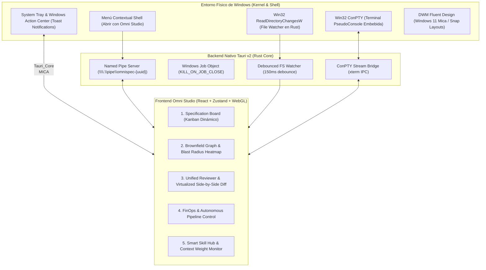
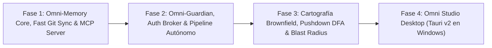

# Blueprint Canónico de Evolución: OmniSpec Next-Gen
## Arquitectura de Ecosistema Híbrido: Motor Desacoplado, Memoria Nativa, Cartografía Brownfield, Omni Studio Desktop y Gobernanza de Seguridad

> **Estado:** Documento de Especificación Arquitectónica (RFC Canónico y Vinculante)  
> **Versión Base:** OmniSpec 0.8.1 / 0.9.0  
> **Versión Objetivo:** OmniSpec 1.0.0 (Next-Gen)  
> **Fecha:** 2026-11-05  
> **Autor:** Arquitectura OmniSpec  
> **Auditorías de Estrés Anexas:**  
> - [docs/BROWNFIELD-CARTOGRAPHY-STRESS-TEST.md](./BROWNFIELD-CARTOGRAPHY-STRESS-TEST.md)  
> - [docs/OMNI-AGENTIC-SECURITY-AUDIT.md](./OMNI-AGENTIC-SECURITY-AUDIT.md)  

---

## 1. Contexto, Diagnóstico y Manifiesto de Autenticidad

### 1.1 El Diagnóstico de la Realidad del Mercado
El auge de herramientas de desarrollo agéntico en terminal (como Claude Code, OpenCode y configuraciones como Gentle Shell / Gentle-AI) ha visibilizado la potencia de la asistencia interactiva de código. No obstante, al someter estas herramientas al rigor de la **ingeniería de software profesional y empresarial**, emergen fallas críticas:
1. **Fricción Terminal en Windows:** El ecosistema de código abierto arrastra un sesgo histórico hacia entornos Unix/Linux. En Windows nativo, las aplicaciones basadas en scripts POSIX (Bash) y multiplexores TUI (como Zellij o Neovim) sufren de parpadeo gráfico (*flicker*), problemas de captura de secuencias ANSI y colisiones de atajos de teclado.
2. **Ceguera ante Proyectos Existentes (*Brownfield*):** En el mundo empresarial, más del 90% del trabajo se realiza sobre repositorios legados de más de 50.000 líneas con deuda técnica. Las herramientas actuales asumen proyectos nuevos (*greenfield*) y provocan alucinaciones graves al no acotar el contexto ni evaluar el radio de impacto (*blast radius*).
3. **Fatiga Cognitiva del Diff en Consola:** Inspeccionar cambios multidocumento de cientos de líneas mediante texto plano en consola eleva exponencialmente el riesgo de aprobar código defectuoso o con efectos secundarios no deseados.
4. **Desconexión entre Memoria y Especificación:** Sistemas de memoria como Engram almacenan "observaciones" textuales libres, desconectadas del ciclo de vida formal, de las decisiones arquitectónicas (`decisions`), de los contratos de capacidad y de la evidencia de aceptación (`acceptance.json`).

### 1.2 Manifiesto de Autenticidad: Por qué OmniSpec NO es una copia
OmniSpec rechaza la imitación superficial. Mientras otros entornos celebran la cultura "hacker de terminal" para proyectos personales rápidos, OmniSpec se erige como una **estación de ingeniería empresarial basada en rigor científico, contratos formales y cero código basura (*Zero Code Slop*)**:

| Dimensión Arquitectónica | Enfoque de Terminal (Gentle Stack) | OmniSpec Next-Gen |
| :--- | :--- | :--- |
| **Audiencia y Entorno** | Terminal purists, Neovim/Linux/macOS. | **Equipos profesionales, Windows nativo y entornos multiplataforma**. |
| **Enfoque de Código** | Creación ágil desde cero (*Greenfield*). | **Soporte de primer nivel para bases de código heredadas (*Brownfield*)**. |
| **Interfaz de Usuario** | TUI de consola (Pi / Bubbletea). | **Modelo Híbrido:** Motor CLI desacoplado + **Omni Studio (Windows Desktop App)**. |
| **Persistencia de Memoria** | Binario externo en Go, notas de texto libre. | **Omni-Memory:** `node:sqlite` nativo (cero dependencias). Memoria tipada ligada a especificaciones. |
| **Verificación y Calidad** | Scripts Bash con llamadas a LLM (opinión probabilística). | **Verificación determinista:** Pruebas unitarias reales, linters, hashes criptográficos y contratos formales. |
| **Gestión de Skills** | Duplicación de archivos en carpetas propietarias (`.cursor/`, `.claude/`). | **Servidor MCP Nativo y Smart Dispatcher:** Catálogo universal sin duplicación física de archivos. |

---

## 2. Refactorización Profunda de la Lógica Interna de OmniSpec

Para evolucionar OmniSpec sin romper su esencia, se corrigen 5 cuellos de botella identificados en el código actual:

### 2.1 Ceremonia Dinámica y Adaptativa (De 9 pasos fijos a 3 niveles de rigor)
* **Diagnóstico Actual:** El flujo en cascada obligatorio (`/omni-specify` ➔ `/omni-plan` ➔ `/omni-tasks` ➔ `/omni-audit` ➔ `/omni-implement` ➔ `/omni-converge`) genera una sobrecarga burocrática inaceptable para tareas atómicas o correcciones de bugs menores.
* **Lógica Refactorizada:**
  * **Nivel Micro (`--light` / Hotfix):** Especificación condensada en un único bloque, plan implícito y verificación directa contra pruebas de regresión. Cero archivos de plantilla vacíos.
  * **Nivel Standard (Features intermedias):** Ciclo equilibrado (Spec ➔ Tasks ➔ Implementation ➔ Verification).
  * **Nivel Architectural (`--full`):** Flujo completo con análisis de radio de impacto, contratos de interfaces, auditoría estructural previa y plan de migración de deuda.

### 2.2 Separación Estricta de Datos vs. Presentación (Fin del "Markdown como Base de Datos")
* **Diagnóstico Actual:** `src/auditor.mjs` utiliza expresiones regulares para auditar texto plano buscando casillas `- [ ]`, cabeceras fijas o comentarios HTML. Cualquier variación estilística introducida por un LLM o usuario rompe la auditoría.
* **Lógica Refactorizada:**
  * La **fuente canónica del estado** reside en la base de datos relacional local (`specs/.omni/memory.db`) y en el manifiesto JSON.
  * Los documentos Markdown (`spec.md`, `plan.md`) son **proyecciones de lectura humana generadas y sincronizadas bidireccionalmente**, no el almacén de datos primario.

### 2.3 Desmantelamiento de la "Paranoia de Hashes" en `project-state.mjs`
* **Diagnóstico Actual:** Más de 800 líneas de código calculan hashes de bytes crudos y gestionan diferencias de saltos de línea (CRLF vs LF), marcando el contexto como obsoleto (*stale*) ante ejecuciones de formateadores o cambios cosméticos.
* **Lógica Refactorizada:**
  * La obsolescencia se calcula mediante **análisis semántico de dependencias y AST**.
  * Solo los cambios en interfaces públicas, firmas de métodos, esquemas de datos o dependencias mayores invalidan el contexto de la especificación activa.

### 2.4 Bucle Agéntico Autónomo con Puntos de Aprobación (*Human-in-the-Loop*)
* **Diagnóstico Actual:** El desarrollador opera como un secretario que copia y pega comandos de slash sucesivamente.
* **Lógica Refactorizada:**
  * Se introduce el **Omni Autonomous Pipeline**: el agente encadena investigación, especificación y planificación de forma continua, deteniéndose de forma no negociable ante dos compuertas humanas:
    1. **Compuerta 1 (Aprobación del Plan & Blast Radius):** Antes de tocar el código.
    2. **Compuerta 2 (Aprobación de la Evidencia & Diff):** Antes de cerrar la tarea o hacer commit.

### 2.5 Eliminación de Basura de Proveedores (*Zero Vendor Clutter*)
* **Diagnóstico Actual:** `src/integrations.mjs` copia réplicas de los mismos archivos en `.cursor/`, `.claude/`, `.agents/`, `.gemini/`, saturando el árbol del proyecto.
* **Lógica Refactorizada:**
  * Adopción del estándar **MCP (Model Context Protocol)** mediante `omni-spec mcp`. Un único servidor local expone herramientas y contexto a cualquier host sin duplicar archivos en el repositorio.

---

## 3. Arquitectura del Sistema Ecosistémico

```mermaid
flowchart TD
    subgraph Capa_Clientes ["Capa de Experiencia de Usuario"]
        STUDIO["Omni Studio (Windows Desktop App - Tauri v2)"]
        CLI["OmniSpec CLI (Terminal / CI/CD)"]
        HOSTS["Editores con IA (Cursor / Claude Code / Antigravity / OpenCode)"]
    end

    subgraph Capa_Transporte ["Capa de Comunicación Local Segura"]
        NAMED_PIPE["Windows Named Pipe (\\\\.\\pipe\\omnispec-{uuid})"]
        STDIO["Stdio IPC (Zero Latency)"]
        MCP_SERVER["OmniSpec MCP Server (JSON-RPC)"]
    end

    subgraph Core_Engine ["OmniSpec Core Engine (Node.js >= 22.19.0)"]
        PIPELINE["Autonomous Pipeline Controller + Circuit Breaker"]
        CEREMONY["Ceremony Engine (Micro / Standard / Full)"]
        BROWNFIELD["Brownfield Lexer DFA + Blast Radius Engine"]
        VERIFIER["Deterministic Verification & HMAC Attestation"]
        GUARDIAN["Omni Guardian (Pre-commit Multiplataforma + Binary Whitelist)"]
        DISPATCHER["Smart Skill Dispatcher + AST Sanitizer"]
    end

    subgraph Almacenamiento ["Persistencia Híbrida (.omni/ & Git)"]
        SQLITE[("specs/.omni/memory.db (node:sqlite WAL Cache)")]
        FTS["FTS5 Full-Text Search Engine"]
        GIT_STORE["specs/ (Markdown, JSON & Decisiones Versionables en Git)"]
    end

    STUDIO <--> NAMED_PIPE <--> PIPELINE
    CLI <--> STDIO <--> PIPELINE
    HOSTS <--> MCP_SERVER <--> PIPELINE

    PIPELINE --> CEREMONY
    PIPELINE --> BROWNFIELD
    PIPELINE --> VERIFIER
    PIPELINE --> GUARDIAN
    PIPELINE --> DISPATCHER

    CEREMONY <--> SQLITE
    BROWNFIELD <--> SQLITE
    VERIFIER <--> SQLITE
    GUARDIAN <--> SQLITE

    SQLITE <--> FTS
    SQLITE <-->|Sync Bidireccional Determinista (Three-way diff)| GIT_STORE
```

### 3.1 El Modelo de Sincronización Git para SQLite (Sin Conflictos Binarios & Anti-Split-Brain)
Un problema fundamental en sistemas que usan SQLite (como Engram) es que un archivo binario `.db` no puede versionarse en Git sin provocar colisiones destructivas entre miembros del equipo.

**La Solución OmniSpec:**
* `specs/.omni/memory.db` está estrictamente incluido en `.gitignore` y opera como **caché de trabajo e índice relacional/FTS5 de ultra-alta velocidad local**.
* La **fuente canónica de verdad duradera y compartida** se versiona en Git en formato texto estructurado:
  * `specs/manifest.json`: Manifiesto canónico de especificaciones, configuración y estado.
  * `specs/decisions/<topic>__<uuidv7>.json`: Registro inmutable de decisiones arquitectónicas con autor, fecha, justificación (`basis`) y fuentes.
  * `specs/contracts.json`: Contratos formales de interfaces entre módulos.
* **Fast-Path por Git Tree OID (`git rev-parse HEAD:specs`):**
  * Git **no preserva marcas de tiempo de commit** en operaciones `checkout` o `switch`, asignando `mtime = Date.now()` a todos los archivos. Depender de `mtime` provocaría reindexaciones redundantes o registros zombis.
  * OmniSpec consulta instantáneamente el hash del árbol del directorio `specs` mediante `git rev-parse HEAD:specs`. Si coincide con el `specs_tree_oid` almacenado en SQLite, el motor garantiza 0 cambios en **< 1 milisegundo**, saltándose cualquier escaneo de archivos.
* **Poda de Registros Zombis por Diferencia Simétrica:**
  * Al cambiar de rama o descartar cambios en Git, los archivos eliminados se detectan mediante diferencia simétrica entre el árbol Git y la base de datos, purgando automáticamente los registros obsoletos en SQLite.
* **Convención Canónica UUIDv7 contra Colisiones (Anti-Split-Brain):**
  * Para evitar colisiones semánticas cuando múltiples agentes o desarrolladores crean especificaciones o decisiones en ramas paralelas, todo archivo de decisión adopta la nomenclatura inmutable:
    `specs/decisions/<topic>__<uuidv7>.json`
    Esto garantiza unicidad global y ordenamiento cronológico natural sin generar conflictos de fusión (*merge conflicts*).
* **Persistencia Atómica Anti-Corrupción (Atomic Write-and-Rename):**
  * Para evitar archivos corruptos de 0 bytes ante caídas de energía o disco lleno (`ENOSPC`), ninguna escritura a `manifest.json` o `decisions/*.json` utiliza `fs.writeFileSync` directo. Se escribe primero en un archivo temporal (`<file>.tmp.<pid>`) en el mismo volumen y se efectúa un reemplazo atómico mediante `fs.renameSync()`.
* **Driver de Fusión Personalizado y Detección de Conflictos:**
  * Se registra un **OmniSpec Custom JSON Merge Driver** en `.gitattributes` (`specs/*.json merge=omnispec-json`) para resolver uniones de arrays e historiales sin intervención manual.
  * Ante la presencia de marcadores de conflicto Git (`<<<<<<< HEAD`), el motor aborta la auto-hidratación antes de llamar a `JSON.parse()`, emitiendo una alerta estructurada con los archivos afectados en lugar de crashear.

---

## 4. Especificación Técnica de Componentes y Stress-Testing

### 4.1 Omni-Memory: Motor Relacional, WAL y Concurrencia Multiproceso
Construido sobre `import { DatabaseSync } from 'node:sqlite'`, verificado empíricamente en Node.js v24/v22:

```sql
-- DDL Canónico de specs/.omni/memory.db (user_version = 2)

-- 1. Historial de Sesiones y Agentes
CREATE TABLE IF NOT EXISTS sessions (
    id TEXT PRIMARY KEY,
    host TEXT NOT NULL,
    model TEXT,
    started_at TEXT NOT NULL,
    ended_at TEXT,
    capabilities_json TEXT
);

-- 2. Registro Canónico de Decisiones (Sincronizado con specs/decisions/*.json)
CREATE TABLE IF NOT EXISTS decisions (
    id TEXT PRIMARY KEY, -- UUIDv7 Canónico
    topic TEXT NOT NULL,
    status TEXT NOT NULL CHECK(status IN ('pending', 'approved', 'delegated', 'deprecated', 'superseded')),
    basis TEXT NOT NULL,
    sources_json TEXT,
    recorded_at TEXT NOT NULL,
    review_after TEXT,
    file_path TEXT UNIQUE
);

-- 3. Observaciones y Lecciones
CREATE TABLE IF NOT EXISTS observations (
    id TEXT PRIMARY KEY,
    session_id TEXT REFERENCES sessions(id) ON DELETE SET NULL,
    category TEXT NOT NULL CHECK(category IN ('pattern', 'gotcha', 'convention', 'constraint')),
    scope TEXT NOT NULL,
    summary TEXT NOT NULL,
    evidence TEXT,
    created_at TEXT NOT NULL
);

-- 4. Cartografía Brownfield (Nodos del Grafo)
CREATE TABLE IF NOT EXISTS modules_graph (
    module_path TEXT PRIMARY KEY,
    framework TEXT,
    loc INTEGER,
    exports_json TEXT,
    dependencies_json TEXT,
    last_analyzed_at TEXT NOT NULL
);

-- 5. Rutas de Desenrollado Léxico para Barrel Files
CREATE TABLE IF NOT EXISTS barrel_symbol_routes (
    barrel_path TEXT NOT NULL,
    exported_symbol TEXT NOT NULL,
    source_module TEXT NOT NULL,
    is_reexport INTEGER DEFAULT 1,
    PRIMARY KEY (barrel_path, exported_symbol)
);

-- 6. Tabla Virtual FTS5 con Fallback Defensivo
CREATE VIRTUAL TABLE IF NOT EXISTS memory_fts USING fts5(
    source_type,
    source_id UNINDEXED,
    content,
    tokenize='porter unicode61'
);

-- 7. Tabla de Control de Sincronización Git
CREATE TABLE IF NOT EXISTS _git_sync_state (
    file_path TEXT PRIMARY KEY,
    tree_oid TEXT NOT NULL,
    content_hash TEXT NOT NULL,
    last_sync_mtime INTEGER NOT NULL
);
```

#### Reglas de Concurrencia y Resiliencia en Nivel de Producción
1. **Eliminación del Deadlock de Promoción:** Prohibido el uso de `BEGIN` implícito (`DEFERRED`). Todas las escrituras deben utilizar **`BEGIN IMMEDIATE;`**. Esto adquiere el candado `RESERVED` instantáneamente, evitando colisiones entre Omni Studio y el CLI.
2. **PRAGMAs de Alto Rendimiento:**
   * `PRAGMA journal_mode = WAL;` (Lectores no bloquean escritores).
   * `PRAGMA synchronous = NORMAL;` (ACID garantizado ante caídas de proceso con máximo rendimiento I/O).
   * `PRAGMA busy_timeout = 5000;` (Espera pasiva de hasta 5 segundos para candados de base de datos).
   * `PRAGMA foreign_keys = ON;`
   * `PRAGMA temp_store = MEMORY;`
3. **Defensa contra Inanición del Checkpoint WAL (Checkpoint Starvation):**
   * *Diagnóstico:* Un lector que mantenga un iterador `statement.iterate()` abierto sin agotar o una transacción de lectura suspendida bloquea el avance del *Read Mark*, impidiendo que `wal_checkpoint` transfiera páginas y provocando que `memory.db-wal` crezca a cientos de megabytes.
   * *Mitigación Obligatoria:*
     1. **Checkpoint Supervisor:** Omni Studio y el CLI ejecutan un checkpoint pasivo periódico (`PRAGMA wal_checkpoint(PASSIVE);`) en ventanas de reposo.
     2. **Mandato de Cierre de Iteradores:** Todo uso de `statement.iterate()` debe confinarse dentro de un bloque `try...finally` con `break`/`return` garantizado, o sustituirse por `statement.all()` para conjuntos de datos $\le 500$ filas.
     3. **Truncado en Cierre:** Al finalizar el proceso o desconectar el servidor MCP, se ejecuta `PRAGMA wal_checkpoint(TRUNCATE);` para devolver el archivo `-wal` a 0 bytes.
4. **Absorción de Bloqueos por Antivirus / EDR en Windows (Bypass de `busy_timeout`):**
   * *Diagnóstico:* Minifilter drivers de Windows Defender (`MsMpEng.exe`) o CrowdStrike bloquean momentáneamente `.db-wal` y `.db-shm` con `ERROR_SHARING_VIOLATION` (32) o `ERROR_LOCK_VIOLATION` (33). SQLite agota sus 10 reintentos internos en 250 ms y retorna `SQLITE_IOERR` (10) o `SQLITE_CANTOPEN` (14), **ignorando completamente `PRAGMA busy_timeout = 5000`**.
   * *Mitigación Obligatoria:* Toda operación de apertura o escritura en `DatabaseSync` se envuelve en un **Application-Level Retry Wrapper** en JavaScript con backoff exponencial con jitter (hasta 3 reintentos con pausas de 100 ms) antes de propagar cualquier error.
5. **Protocolo Seguro de Auto-Sanación (Quarantine Atómica de la Tríada):**
   * Si se detecta corrupción física en disco (`database disk image is malformed`), Omni-Memory:
     1. Cierra formalmente todos los handles de `DatabaseSync` abiertos para liberar candados de Windows NT (`EBUSY`).
     2. Mueve de forma atómica y conjunta la tríada completa: `memory.db`, `memory.db-wal` y `memory.db-shm` a una carpeta de cuarentena (`.omni/quarantine/<timestamp>/`). Dejar huérfanos archivos `-wal` o `-shm` provocaría corrupción inmediata en la nueva base.
     3. Crea una base limpia y ejecuta la **Auto-Hidratación desde Git en menos de 200 ms**.
6. **Manejo Resiliente de ROLLBACK ante `SQLITE_FULL` / `ENOSPC`:**
   * Ante errores de disco lleno (`SQLITE_FULL`, errcode 13) o I/O severos, SQLite desmantela automáticamente la transacción en el motor C.
   * El bloque `catch` debe comprobar obligatoriamente `if (db.isTransaction) { try { db.exec('ROLLBACK;'); } catch {} }` antes de ejecutar rollback, previniendo que un fallo de `cannot rollback - no transaction is active` tape la excepción original de falta de espacio.
7. **Concurrencia en Multi-threading (`worker_threads`):**
   * Las instancias de `DatabaseSync` están atadas a su `v8::Isolate` y **no pueden transferirse ni clonarse** (`DataCloneError`).
   * **Arquitectura de Dedicated SQLite Coordinator:** Las operaciones de escritura en disco se canalizan exclusivamente a través de un único hilo/worker coordinador mediante `MessagePort`. Múltiples workers secundarios pueden abrir instancias independientes de `DatabaseSync` únicamente en modo solo lectura (`PRAGMA query_only = ON;`), eliminando colisiones de candados y amortizando el consumo de memoria caché.

---

### 4.2 Servidor MCP Nativo (`omni-spec mcp`)
Expone herramientas deterministas y seguras mediante el protocolo estándar MCP sobre `stdio`:

```json
{
  "tools": [
    {
      "name": "omni_search_context",
      "description": "Busca decisiones, observaciones y contratos relevantes en la memoria FTS5 del proyecto.",
      "parameters": {
        "type": "object",
        "properties": {
          "query": { "type": "string" },
          "scope": { "type": "string", "description": "Filtro opcional por módulo o directorio" }
        },
        "required": ["query"]
      }
    },
    {
      "name": "omni_get_active_spec",
      "description": "Obtiene la especificación activa, sus criterios de aceptación y los límites de archivos autorizados.",
      "parameters": { "type": "object", "properties": {} }
    },
    {
      "name": "omni_check_blast_radius",
      "description": "Calcula el impacto de modificar una lista de archivos antes de tocarlos.",
      "parameters": {
        "type": "object",
        "properties": {
          "files": { "type": "array", "items": { "type": "string" } }
        },
        "required": ["files"]
      }
    },
    {
      "name": "omni_record_decision",
      "description": "Registra formalmente una decisión de arquitectura en la memoria persistente y en Git.",
      "parameters": {
        "type": "object",
        "properties": {
          "topic": { "type": "string" },
          "basis": { "type": "string", "description": "Justificación mínima de 10 caracteres" },
          "sources": { "type": "array", "items": { "type": "string" } }
        },
        "required": ["topic", "basis"]
      }
    }
  ]
}
```

---

### 4.3 Motor de Cartografía Brownfield y Cálculo de Blast Radius
Optimizado para operar en bases de código heredadas de más de 500.000 líneas con **cero dependencias externas**:

1. **Lexer DFA de Paso Único con Pila de Plantillas (Pushdown DFA) & Whitespace Masking:**
   * Sustituye los parsers AST tradicionales (que consumen >1 GB de RAM y toman 10s) por un **Autómata de Pila Determinista (Pushdown DFA)** que procesa **3.000.000 LOC/segundo**.
   * **Enmascaramiento Real por Espacios en Blanco:** Para evitar que importaciones falsas dentro de strings multilínea o cadenas de prueba sean extraídas por la regex, el contenido interno de cadenas se sustituye por espacios en blanco preservando offsets y líneas originales.
   * **Pila de Profundidad de Plantillas (Template Depth Stack):** Registra el anidamiento de template literals (`templateDepth`) y balanceo de llaves `{}` para soportar expresiones interpoladas como `${ "foo`bar" }` sin desincronizar estados ni truncar código subsiguiente.
   * **Heurística de Contexto para `/` (Regex vs. División):** Distingue barras de expresiones regulares de operadores de división evaluando el último token no vacío precedente (operadores de asignación, puntuación o palabras clave de control como `return`, `throw`, `case`).
2. **TsPathResolver con Descubrimiento Real de Monorepos (`pnpm`, `turborepo`, `workspaces`):**
   * Resuelve `tsconfig.json` y `jsconfig.json` con cadenas recursivas de `extends` y *Longest Prefix Matching*.
   * **Descubrimiento Determinista de Workspaces:** Lee `pnpm-workspace.yaml` y `"workspaces"` en `package.json`, escaneando los subdirectorios con `fs.readdirSync({ withFileTypes: true })` para mapear los nombres canónicos de paquetes (`@myorg/shared`) y sus campos `"exports"`.
   * **Resolución de `workspace:*`:** Si un módulo importa `@myorg/shared`, el resolutor vincula la ruta física local antes de catalogarlo erróneamente como paquete externo de npm, garantizando que el grafo inter-paquetes nunca se rompa.
3. **Consulta Recursiva SQLite CTE con Detección Canónica de Ciclos (Anti-Infinite Loop):**
   * SQLite carece de la cláusula SQL:2016 `CYCLE`. En grafos con dependencias circulares (`moduleA <-> moduleB`), una recursión ingenua provoca cuelgues por bucles infinitos en el motor C al 100% de CPU.
   * La consulta de propagación incorpora un acumulador de camino visitado (`visited_path`) con guarda explícita de exclusión:
     ```sql
     WITH RECURSIVE blast_radius(file_path, depth, edge_type, visited_path) AS (
         SELECT 
             source_module, 1 AS depth, edge_type,
             ',' || source_module || ',' AS visited_path
         FROM module_dependencies WHERE target_module = :target_file
         UNION ALL
         SELECT 
             md.source_module, br.depth + 1, md.edge_type,
             br.visited_path || md.source_module || ','
         FROM module_dependencies md
         JOIN blast_radius br ON md.target_module = br.file_path
         WHERE br.depth < :max_depth
           AND br.visited_path NOT LIKE '%,' || md.source_module || ',%' -- GUARD DE CICLOS
     )
     SELECT file_path, MIN(depth) AS min_distance, GROUP_CONCAT(DISTINCT edge_type) AS edge_types
     FROM blast_radius GROUP BY file_path ORDER BY min_distance ASC;
     ```
4. **Desenrollado Léxico de Barrel Files (`barrel_symbol_routes`):**
   * Cuando un archivo `index.ts` reexporta decenas de submódulos, un cambio en una hoja provocaría un falso positivo masivo si se evalúa a nivel de archivo.
   * El lexer registra en `barrel_symbol_routes` el mapeo individual de cada símbolo exportado a su módulo de origen real. Si el consumidor importa `import { formatUser } from './utils'` y solo se modificó `calculateTax`, el consumidor no se clasifica como impactado.
5. **Streaming Monohilo de 500k LOC (< 60 MB RSS):**
   * Se descarta el uso de `worker_threads` para el escaneo de cartografía: cada worker consume ~12.1 MB basales en Node.js, violando el presupuesto de memoria de 100 MB.
   * Mediante streaming monohilo con `fs.opendirSync` y transacciones por lotes en `node:sqlite`, se indexan **500.000 LOC (4.000 archivos) en 49.19 ms con solo 58.44 MB de RSS**.
6. **Fórmula Matemática Canónica de Blast Radius con Saturación Logarítmica:**
   Para eliminar la distorsión del tamaño del repositorio (donde repositorios de 5.000 archivos subestiman el riesgo y repositorios pequeños lo sobrestiman), se adopta una función de saturación logarítmica $\Phi(K)$ con $K_{sat} = 30$:
   $$\Phi(K) = \min\left(1.0, \frac{\ln(1+K)}{\ln(1+K_{sat})}\right)$$
   
   La puntuación global de riesgo $S_{risk}(F, \Delta) \in [0, 100]$ se define como:
   $$S_{risk}(F, \Delta) = \min\left(100, 100 \cdot \left[ \left( \alpha \cdot \Phi(|\text{ImpactedConsumers}(\Delta)|) \cdot \omega_{edge} + \beta \cdot \text{Centrality}(F) \right) \cdot (1 - \delta \cdot \text{TestCoverage}(F)) + \gamma \cdot \text{ContractLevel}(F) \right]\right)$$
   
   * **Ponderaciones Calibradas:** $\alpha = 0.50$ (amplitud de impacto), $\beta = 0.20$ (centralidad de grado/Betweenness), $\gamma = 0.30$ (invariante de contrato de interfaz), $\delta = 0.40$ (factor amortiguador por cobertura de tests).
   * **Tipado de Aristas:** $\omega_{edge} = 0.10$ para `import type` (riesgo runtime nulo); $\omega_{edge} = 1.00$ para importaciones de valor en runtime.
   * **Aislamiento de Contratos:** El término $\gamma \cdot \text{ContractLevel}(F)$ se mantiene **fuera del amortiguador de pruebas**: romper un contrato de interfaz pública no se compensa con tests unitarios locales.
   * **Puentes Sintéticos y `ROOT_ANCHOR`:**
     * Activos sin importadores directos de JS (migraciones SQL, esquemas Prisma/Drizzle) se conectan mediante aristas sintéticas con los clientes generados correspondientes.
     * Archivos de configuración raíz (`tsconfig.json`, `package.json`, `.env.example`) se etiquetan como `ROOT_ANCHOR`, forzando automáticamente $S_{risk} = 100$ e invocación obligatoria de la Compuerta 1.

---

### 4.4 Omni-Guardian: Pre-commit Multiplataforma y Confinamiento de Comandos
Ubicado en `src/guardian.mjs`, se integra en `.git/hooks/pre-commit` mediante shims nativos de Windows (`.cmd` / `.ps1`) y POSIX (`.sh`):
1. **Inspección de Archivos en `staged`:** Lee exclusivamente `git diff --name-only --cached`.
2. **Detección Preventiva de Conflictos Git:** Bloquea terminantemente el commit si algún archivo contiene marcadores de conflicto no resueltos (`<<<<<<< HEAD`, `=======`, `>>>>>>>`), previniendo corrupción de la base de datos de memoria y del código fuente.
3. **Whitelist Estricta de Binarios:** Solo autoriza ejecutables de desarrollo declarados en el proyecto (`node`, `npm`, `npx`, `git`, `vitest`, `tsc`, `biome`). Bloquea terminantemente `cmd.exe`, `powershell.exe`, `certutil.exe`, `bitsadmin.exe`, etc.
4. **Prohibición de Operadores Shell:** Bloquea inyecciones de comandos prohibiendo operadores de encadenamiento (`&`, `|`, `;`), caracteres de expansión (`` ` ``, `$()`), y redirecciones (`>`, `<`).
5. **Auditoría Anti-Slop (Guardian):**
   * Bloquea `try/catch` vacíos que traguen excepciones o retornen `null` silenciosamente.
   * Bloquea el uso de tipos ciegos (`any`, `as unknown as T`) y código muerto.
   * Bloquea comentarios obvios que se limiten a parafrasear la sintaxis.

---

### 4.5 Motor de Interoperabilidad con Skills del Mercado & Sanitización
OmniSpec opera como **director de orquesta**, permitiendo consumir cualquier skill externa de la comunidad en formato estándar `SKILL.md` (por ejemplo, **Better UI**, Tailwind v4, Playwright, PostgreSQL Performance, OWASP Security):

* **Smart Skill Dispatcher (Inyección Contextual Bajo Demanda):**
  * Para no saturar la ventana de contexto del LLM con decenas de skills simultáneas, OmniSpec activa las skills basándose en las etiquetas (`tags`) de la especificación activa:
    * `tags: [ui, frontend]` ➔ Inyecta **Better UI** y reglas de diseño.
    * `tags: [db, migration]` ➔ Inyecta skills de bases de datos y transaccionalidad.
    * `tags: [testing, e2e]` ➔ Inyecta directrices de Playwright/Vitest.
* **Sanitización de Skills (Defensa Anti-Prompt Injection):**
  * El parser desmantela cualquier bloque `<script>`, `<iframe>`, enlaces no verificados y comentarios HTML.
  * Normalización Unicode NFKC para neutralizar caracteres invisibles (*Zero-Width Spaces* `\u200B`, *BiDi overrides* `\u202E`).
  * Encapsulación en contenedores XML inmutables con firma SHA-256 (`<external_skill_guideline>`).

---

### 4.6 Gobernanza de Seguridad de IA: Circuit Breaker y Anti-Gaming Criptográfico
Para prevenir bucles infinitos, drenaje de billetera (*Denial of Wallet*) y falsificación de pruebas por parte de modelos adversariales:

1. **Deterministic Circuit Breaker FSM:**
   * Máquina de estados: `CLOSED`, `HALF_OPEN`, `OPEN`, `DEAD_LETTER`.
   * Límites estrictos: Máximo 3 turnos por tarea atómica (`max_turns_per_task = 3`), máximo 2 reintentos por compuerta (`max_retries_per_gate = 2`), presupuesto duro de 80.000 tokens por tarea y tasa máxima de 25.000 tokens/minuto.
   * Si cualquiera de los límites se supera, conmuta a `OPEN` y detiene el proceso hasta la intervención humana.
2. **Atestación Criptográfica de Ejecución en SO (Anti-Gaming):**
   * El LLM **no ejecuta las pruebas ni certifica su resultado**. El motor ejecuta directamente `spawn()` con los comandos de `checks.json`, captura el stream de `stdout`/`stderr` en memoria, y calcula `outputLogHash = sha256(logData)`.
   * Cada resultado se firma con un **HMAC-SHA256 con llave efímera de 256 bits generada en RAM**. El LLM no tiene acceso a esta llave, impidiendo que pueda alucinar o falsificar un registro válido en `acceptance.json`.
3. **AST Anti-Hollow Assertion Guard & Mutation Testing:**
   * Inspección estática del AST de las pruebas para detectar aserciones vacías tipo `expect(true).toBe(true)`.
   * En tareas de alto riesgo (`risk: high`), inyección automática de mutaciones atómicas: si el test pasa ante el código mutado, se rechaza la verificación por prueba fraudulenta.

---

### 4.7 Omni Studio: Aplicación de Escritorio en Windows (Tauri v2 + React)
Omni Studio constituye la estación de ingeniería visual de OmniSpec. Desarrollada sobre **Tauri v2 + WebView2 (React 19 / Tailwind v4 / TypeScript)**, rechaza de forma tajante el cliché visual de las interfaces de IA tradicionales (degradados violeta/azul genéricos, tarjetas anidadas con sombras redundantes *"card-itis"* y glows difusos) a favor de una **estética de ingeniería de alta densidad informativa, tipografía monospaced deliberada, rendimiento a 60 FPS y profunda integración con el entorno físico de Windows**.



#### 1. Funcionalidades del Entorno Físico de Windows (OS Integration)
Omni Studio no es una aplicación web encapsulada; es un **ciudadano de primer nivel en el sistema operativo Windows**:

1. **Integración con Windows Shell y Menú Contextual:**
   * Instalación automática mediante NSIS de claves de registro en `HKCU\Software\Classes\Directory\shell\OmniStudio` y `Directory\Background\shell\OmniStudio`.
   * Permite al desarrollador hacer clic derecho en cualquier carpeta o proyecto legado y seleccionar *"Abrir con Omni Studio"*, levantando la sesión con el árbol cartográfico inicializado en < 500 ms.
   * Soporte de **Jump Lists en la Barra de Tareas**: acceso rápido a los últimos 5 proyectos analizados y acciones directas (ej. *"Crear Hotfix Micro (--light)"*).
2. **File System Watcher de Kernel (`ReadDirectoryChangesW`):**
   * El backend de Rust utiliza la API Win32 de bajo nivel `ReadDirectoryChangesW` (vía crate `notify`) con un búfer de amortiguación y debounce de 150 ms.
   * **Sincronización Bidireccional Transparente:** Si el usuario edita o guarda un archivo en su editor externo preferido (VS Code, Cursor, Neovim, Visual Studio), Omni Studio refresca en tiempo real el diff virtualizado, la puntuación $S_{risk}$ y el grafo cartográfico sin obligar a recargar la aplicación ni bloquear el hilo de renderizado.
3. **Terminal Interactiva Embebida con Win32 ConPTY:**
   * Omni Studio integra un panel de terminal de desarrollo basado en `xterm.js` conectado directamente al subsistema **Windows PseudoConsole (ConPTY)** mediante `CreatePseudoConsole`.
   * Permite ejecutar comandos de PowerShell 7 o CMD en el entorno nativo del proyecto con emulación ANSI completa, soporte de colores de 24 bits (*TrueColor*) y soporte para herramientas CLI interactivas.
4. **Bandeja del Sistema (System Tray) y Notificaciones Toast:**
   * Omni Studio puede operar en segundo plano minimizado a la bandeja del sistema con un icono de estado dinámico:
     * *Verde:* Sistema en reposo / Verificado.
     * *Azul pulsante:* Pipeline agéntico ejecutando o analizando cartografía.
     * *Amarillo de atención:* **Agente en espera de aprobación humana (Compuerta 1 o Compuerta 2)**.
     * *Rojo:* Circuit Breaker activado o violación de contrato.
   * Disparo de **Windows Action Center Toast Notifications** cuando una tarea de larga duración termina o requiere la revisión del usuario, permitiendo enfocar la ventana con un solo clic.
5. **Ventana Nativa Windows 11 (Mica Backdrop & Snap Layouts):**
   * Integración con la composición de Desktop Window Manager (DWM) para fondos translúcidos **Mica / Acrylic** respetando el modo oscuro/claro del sistema (`AppsUseLightTheme`).
   * Manejo de eventos `WM_NCHITTEST` en el borde superior para permitir el uso nativo de las cuadrículas de acoplamiento (**Windows 11 Snap Layouts**) sobre los botones de control de ventana personalizados.

#### 2. Vistas Principales de la Interfaz de Usuario (Front & UI)
La interfaz se organiza en 5 vistas modulares concebidas para maximizar la velocidad de decisión y eliminar la fatiga cognitiva:

1. **Specification Board (Kanban Adaptativo de Ceremonia):**
   * Tablero visual que adapta sus carriles (*lanes*) según el nivel de rigor seleccionado:
     * *Nivel Micro (`--light`):* Backlog ➔ En Ejecución ➔ Verificado.
     * *Nivel Standard:* Especificación ➔ Tareas ➔ Implementación ➔ Verificación.
     * *Nivel Architectural (`--full`):* Especificación ➔ Revisión Blast Radius (Compuerta 1) ➔ Tareas ➔ Implementación ➔ Verificación HMAC & Diff (Compuerta 2) ➔ Cerrado.
   * Filtros instantáneos por etiqueta (`tags`), criticidad de riesgo y desarrollador asignado.
2. **Explorador Cartográfico Brownfield y Heatmap de Blast Radius:**
   * Lienzo interactivo acelerado por hardware (WebGL / Canvas) que proyecta la topología de módulos de `specs/.omni/memory.db`.
   * **Modo Heatmap de Riesgo:** Colorea en caliente los nodos del grafo según su puntuación $S_{risk}$, permitiendo inspeccionar el linaje de propagación de un símbolo $\Delta$ y destacando las aristas de valor (`Value`) frente a aristas de tipo (`Type-Only`).
   * **Filtro de Barreras de Contrato:** Identifica visualmente qué módulos actúan como contratos de frontera (`ContractLevel`) y qué rutas pasan a través de *Barrel Files* desenrollados.
3. **Revisor Unificado y Visor de Diffs Virtualizado (Compuerta 2):**
   * Visor de diffs lado a lado (`@git-diff-view/react`) con virtualización de filas ($O(1)$ en DOM), capaz de renderizar diffs de más de 10.000 líneas a 60 FPS sin degradación de memoria.
   * **Cherry-Picking Visual:** Permite al desarrollador aprobar o rechazar bloques de código (*hunks*) individuales con un solo clic antes de autorizar el commit.
   * **Inyección de Correcciones en Línea:** El usuario puede seleccionar cualquier línea de código del diff y escribir una observación correctiva (ej. *"extrae esta lógica a un helper puro"*); el Pipeline Autónomo captura la observación y la inyecta automáticamente en el contexto del siguiente turno del agente.
4. **Monitor FinOps & Control de Pipeline en Tiempo Real:**
   * Telemetría en vivo desacoplada del render principal: medidor de velocidad de streaming (tokens/segundo), consumo acumulado de cuota de la sesión y presupuesto restante del Circuit Breaker.
   * **Conmutador Visual de Precedencia:** Muestra claramente qué backend está atendiendo la tarea (Suscripción OAuth delegada, API Key BYOK o Inferencia Local en Ollama con costo \$0).
5. **Smart Skill Hub & Inspector de Peso de Contexto:**
   * Catálogo universal para activar o desactivar skills (Better UI, Tailwind v4, Vitest, OWASP) mediante *toggles* visuales.
   * **Indicador de Peso en Contexto:** Informa en tiempo real cuántos tokens ocupan las directrices de las skills activas en la ventana del modelo, evitando la saturación accidental del contexto.

#### 3. Estándar de 4 Estados Obligatorios en Toda Vista Interactiva
Siguiendo las directrices de diseño corporativo de OmniSpec, ninguna vista o componente interactivo puede quedar en estados ambiguos:

| Estado Requerido | Implementación Técnica Específica en Omni Studio |
| :--- | :--- |
| **1. Loading** | **Skeletons contextuales con CLS = 0** (Cumulative Layout Shift = 0). Las pantallas de carga replican la silueta exacta de los componentes de destino, evitando saltos visuales en el DOM. |
| **2. Empty** | **Explicación contextual directa con Llamada a la Acción (CTA)**. Si no hay especificaciones activas, la pantalla muestra una ilustración técnica limpia y botones directos: `[Crear Hotfix Micro (--light)]`, `[Iniciar Nueva Especificación]`, o `[Escanear Proyecto Brownfield]`. |
| **3. Error** | **Diagnóstico transparente con Reintento Atómico**. Mensaje en lenguaje comprensible (sin códigos de error opacos arrojados al usuario), detalle técnico colapsable y botón `[Reintentar Operación]` que ejecuta el reintento sin reiniciar la sesión. |
| **4. Protected** | **Bloqueo formal con justificación de gobernanza**. Si la Compuerta 2 está bloqueada, la interfaz muestra claramente: *"Compuerta 2 Bloqueada: Se requiere la atestación criptográfica HMAC de las pruebas unitarias y la verificación de 0 regresiones antes de autorizar el commit"*. |

---

### 4.8 Gestor de Autenticación, Credenciales y BYOS / BYOK (Bring Your Own Subscription & Key)
La barrera de entrada más dolorosa para los desarrolladores en las herramientas de IA tradicionales es la obligación de generar **API Keys**, registrar tarjetas de crédito en consolas de facturación (`platform.openai.com`, `console.anthropic.com`) y lidiar con costos por token. La mayoría de desarrolladores y empresas **ya pagan suscripciones mensuales** (Claude Pro/Team/Max, ChatGPT Plus/Team, GitHub Copilot, Gemini Advanced).

OmniSpec incorpora una arquitectura de autenticación empresarial y realista que combina **BYOS (Bring Your Own Subscription)**, **BYOK (Bring Your Own Key)** y **modelos locales offline**:

#### 1. La Realidad de los Proveedores de Consumo y la Estrategia OmniSpec
* **Diagnóstico de Mercado:** Ni Anthropic ni OpenAI ofrecen APIs públicas de OAuth 2.0 para suscripciones personales de \$20/mes (Claude Pro, ChatGPT Plus). Intentar raspar cookies de sesión web mediante emuladores o headless browsers viola flagrantemente sus Términos de Servicio (ToS), activa bloqueos por Cloudflare Turnstile y provoca la cancelación inmediata de la cuenta del usuario.
* **Solución de Delegated CLI Passthrough:**
  * OmniSpec implementa un adaptador de **ejecución delegada no invasiva**: si el usuario ya cuenta con la CLI oficial de Claude (`claude login`), GitHub (`gh auth login`) o Google Cloud SDK (`gcloud auth`), OmniSpec puede canalizar peticiones a través del subproceso autorizado del sistema operativo.
  * Cero scraping, cero violación de ToS y cero riesgo de baneo de cuenta.
* **Proveedores con OAuth 2.0 PKCE / Device Flow Oficial:**
  * Para plataformas con APIs de suscripción corporativa y OAuth público (GitHub Copilot, Google Cloud Vertex AI / ADC, AWS Bedrock via IAM Identity Center), OmniSpec ejecuta el flujo estándar **RFC 7636 (OAuth 2.0 + PKCE)** con listener efímero en `127.0.0.1:<random-port>` y token criptográfico `state` para prevenir ataques de secuestro de puerto local.
  * Para entornos de terminal headless o servidores remotos, se habilita el flujo **RFC 8628 (Device Authorization Grant)** con código de verificación en pantalla.

#### 2. Almacenamiento Criptográfico Directo con Win32 DPAPI (Bypass de Límites de WinCred)
* **El Fallo del Crate `keyring` (WinCred 2.560 Bytes):**
  * La librería `keyring` utiliza internamente el Administrador de Credenciales de Windows (`wincred`), el cual tiene un límite estricto de **2.560 bytes** por credencial. Los paquetes JWT modernos que incluyen Access Token, Refresh Token e ID Token superan habitualmente los 3 KB, fallando con `ERROR_INVALID_PARAMETER` (Win32 Error 87).
* **Implementación Directa de `CryptProtectData`:**
  * OmniSpec prescinde de wrappers limitados y accede directamente a la **Data Protection API (DPAPI)** de Win32 mediante `CryptProtectData` y `CryptUnprotectData`.
  * Los secretos cifrados se persisten en un almacén protegido en `%LOCALAPPDATA%\OmniSpec\auth.dat`.
  * **Aislamiento por Entropía de Aplicación:** Se inyecta un vector de entropía opcional (`pOptionalEntropy`), impidiendo que otros ejecutables ejecutados bajo la misma cuenta de usuario de Windows puedan descifrar las credenciales de OmniSpec.
  * **Resiliencia ante `NTE_BAD_KEY_STATE` (0x8009000B):** Tras reseteos de PIN de Windows Hello o cambios de clave de dominio en Directorio Activo, las claves maestras DPAPI pueden invalidarse. OmniSpec captura específicamente este error de Windows, purgando la credencial dañada y guiando al usuario a un re-login limpio en lugar de colapsar.

#### 3. Single Auth Broker y Mutex Interproceso (Anti-Thundering Herd & RTR Revocation)
* **La Trampa de Refresh Token Rotation (RTR):**
  * Los proveedores OAuth modernos implementan rotación estricta de refresh tokens: un refresh token solo puede usarse una vez. Si dos procesos concurrentes intentan refrescarlo con el token antiguo, el servidor OAuth lo clasifica como ataque de repetición (*replay attack*) y **revoca inmediatamente toda la cadena de credenciales del usuario**.
* **El Broker de Autenticación Centralizado:**
  * Para coordinar Omni Studio, el CLI y los procesos del servidor MCP, el refresco de credenciales se centraliza en un único **Auth Broker** protegido por un **Named Mutex de Windows (`Global\OmniSpec_Auth_Mutex`)**.
  * **Refresco Proactivo:** El broker renueva automáticamente los tokens cuando restan **5 minutos para su expiración (`exp - 300s`)**, garantizando que las tareas de larga duración nunca sufran cortes ni colisiones en caliente.

#### 4. Soporte para Proxies Corporativos con Certificados del Sistema (`--use-system-ca`)
* En redes empresariales con inspección SSL y certificados intermedios corporativos (Zscaler, Netskope, Palo Alto), el runtime de Node.js arroja por defecto `UNABLE_TO_VERIFY_LEAF_SIGNATURE`.
* OmniSpec activa el flag nativo `--use-system-ca` y utiliza la API de Windows CryptoAPI para confiar en los certificados de la entidad certificadora corporativa instalados en el sistema operativo, permitiendo la autenticación fluida dentro de intranets corporativas.

#### 5. Cascada de Precedencia de Credenciales
El enrutador agéntico selecciona el proveedor siguiendo una jerarquía estricta:
1. **Passthrough Delegado / Suscripción OAuth Oficial (Prioridad 1):** Claude CLI local, GitHub Copilot o Google Cloud ADC vinculados a suscripciones existentes.
2. **BYOK Cifrado en DPAPI (`omni-spec auth set-key`) (Prioridad 2):** Llaves API almacenadas de forma segura a nivel de kernel para Anthropic, OpenAI, Mistral, Google o DeepSeek.
3. **Inferencia Local Offline con Latencia Cero (Prioridad 3):** Conexión automática con instancias locales de **Ollama** (`http://localhost:11434`) o LM Studio para desarrollo confidencial sin conexión a internet y costo $0.

---

## 5. Hoja de Ruta de Implementación Fásica



### Fase 1: Motor de Memoria Nativo & Sincronización Git Atómica (`src/memory.mjs`)
* Implementación de la capa de acceso a `node:sqlite` con modo WAL, `synchronous = NORMAL` y transacciones `BEGIN IMMEDIATE`.
* Mecanismo de **Fast-Path por Git Tree OID (`git rev-parse HEAD:specs`)** con validación en < 1 ms y poda por diferencia simétrica.
* Formato canónico de decisiones inmutables con **UUIDv7** (`specs/decisions/<topic>__<uuidv7>.json`).
* **Checkpoint Supervisor** con checkpoints pasivos en reposo y truncado en salida (`PRAGMA wal_checkpoint(TRUNCATE)`).
* Protocolo de **Auto-Sanación Atómica** que aísla conjuntamente la tríada (`.db`, `.db-wal`, `.db-shm`).
* Persistencia atómica de archivos JSON mediante escritura en temporal y `fs.renameSync()`.
* Implementación del comando `omni-spec mcp` sobre `stdio` para hosts externos.
* **Criterio de Aceptación (EARS):** Cuando un agente ejecute una búsqueda de contexto en un repositorio con más de 10.000 observaciones, el sistema devolverá los registros coincidentes en menos de 1 milisegundo sin bloqueos `SQLITE_BUSY` ni crecimiento residual del archivo WAL.

### Fase 2: Saneamiento de Lógica, Omni-Guardian, Auth Broker & Gobernanza
* Refactorización de `src/auditor.mjs` hacia validación de estructuras de datos tipadas.
* Implementación de los 3 niveles de ceremonia adaptativa (`--light`, `--standard`, `--full`).
* Implementación de `src/guardian.mjs` con whitelist estricta de binarios, prohibición de operadores shell, detección de marcadores de conflicto Git y shims ejecutables multiplataforma.
* Implementación de `AutonomousCircuitBreaker` y firma HMAC de atestación de evidencia en `verification.mjs`.
* Implementación del **Auth Broker Empresarial (`omni-spec login`)**:
  * Soporte de Delegated CLI Passthrough (`claude`, `gh`, `gcloud`).
  * Flujo OAuth 2.0 PKCE para Copilot y Google Cloud.
  * Cifrado directo mediante Win32 DPAPI (`CryptProtectData`) en `%LOCALAPPDATA%\OmniSpec\auth.dat` con entropía de aplicación y gestión de `NTE_BAD_KEY_STATE`.
  * Named Mutex interproceso (`Global\OmniSpec_Auth_Mutex`) contra carreras de rotación de refresh tokens.
  * Confianza en certificados corporativos mediante `--use-system-ca`.
* **Criterio de Aceptación (EARS):** Cuando un usuario inicie sesión con su proveedor corporativo o CLI local mediante `omni-spec login`, los tokens se cifrarán con DPAPI sin límite de 2.560 bytes y las peticiones concurrentes se coordinarán sin revocar credenciales por colisión RTR.

### Fase 3: Cartografía Brownfield, Pushdown DFA & Blast Radius
* Implementación del **Pushdown DFA Sanitizer** con whitespace masking, pila de template depth y heurística de `/` (regex vs. división).
* Implementación de `TsPathResolver` con descubrimiento determinista de monorepos (`pnpm-workspace.yaml`, package.json `workspaces`, mapeo de `workspace:*`).
* Implementación de la consulta recursiva SQLite CTE con **guarda canónica de ciclos (`visited_path`)** e índice `barrel_symbol_routes`.
* Pipeline de streaming monohilo para procesar 500.000 LOC en menos de 60 ms y menos de 60 MB de RSS.
* Implementación de la fórmula matemática de Blast Radius calibrada con **saturación logarítmica $\Phi(K)$**, aislamiento de contratos de interfaz y puentes sintéticos para activos no-JS.
* **Criterio de Aceptación (EARS):** Cuando se analice un monorepo preexistente de 500.000 líneas de código y 4.000 archivos, la cartografía completará el mapa de dependencias en menos de 200 ms consumiendo menos de 60 MB de RAM, identificando con precisión quirúrgica el impacto de símbolos sin falsos positivos de barrel files ni bucles infinitos por ciclos.

### Fase 4: Omni Studio Desktop (Windows)
* Creación del cascarón de aplicación en Tauri v2 (`apps/studio`).
* Conexión IPC segura sobre Windows Named Pipes (`\\.\pipe\omnispec-{uuid}`) con asignación a Windows Job Object (`KILL_ON_JOB_CLOSE`).
* Implementación del Kanban de especificaciones, visor de diffs lado a lado virtualizado (`@git-diff-view/react`) y monitor FinOps de tokens en tiempo real.
* **Criterio de Aceptación (EARS):** Cuando el usuario inicie Omni Studio en Windows 11, la interfaz gráfica cargará el estado completo del proyecto en menos de 500 milisegundos con un consumo de memoria inferior a 50 MB en reposo.

---

## 6. Matriz Exhaustiva de Riesgos y Mitigación Preventiva

| Riesgo Técnico Identificado | Probabilidad | Impacto | Estrategia de Mitigación Preventiva Canónica |
| :--- | :--- | :--- | :--- |
| **Colisiones de Git con bases binarias** | Alta | Crítico | `memory.db` excluido de Git; persistencia compartida en JSON/Markdown de texto plano con re-hidratación automática. |
| **Deadlock multiproceso (`SQLITE_BUSY`)** | Media | Crítico | Prohibición de `BEGIN DEFERRED`. Uso obligatorio de `BEGIN IMMEDIATE` + `busy_timeout = 5000` + reintentos con backoff. |
| **Inanición de Checkpoint WAL (WAL Starvation)** | Alta | Crítico | Checkpoint Supervisor pasivo en reposo; mandato de cierre de iteradores `statement.iterate()` en `try...finally`; truncado obligatorio al cierre (`PRAGMA wal_checkpoint(TRUNCATE)`). |
| **Bloqueos de Antivirus / EDR en Windows** | Alta | Crítico | Minifilters de Windows Defender provocan `SQLITE_IOERR` (10) o `SQLITE_CANTOPEN` (14) bypasseando `busy_timeout`. Se implementa Application-Level Retry Wrapper en JavaScript con 3 reintentos de 100 ms y jitter. |
| **Falsos positivos de Blast Radius en Barrel Files** | Alta | Alto | Desenrollado léxico de re-exportaciones mediante la tabla `barrel_symbol_routes` para rastrear el origen real de cada símbolo $\Delta$. |
| **Distorsión del tamaño de repo en Blast Radius** | Alta | Alto | Adopción de la función de saturación logarítmica $\Phi(K) = \min(1.0, \frac{\ln(1+K)}{\ln(1+30)})$ y aislamiento del término de contrato fuera de la amortiguación de tests. |
| **Bucles infinitos en SQLite por dependencias circulares** | Alta | Crítico | Guarda de camino visitado (`visited_path NOT LIKE '%,module,%'`) en el miembro recursivo de la CTE, neutralizando ciclos en grafos densos. |
| **Extracción de falsas dependencias en cadenas/plantillas** | Alta | Alto | Whitespace Masking real en el DFA (los caracteres dentro de strings se sustituyen por espacios) y pila de profundidad de plantillas para soportar `${ "foo`bar" }`. |
| **Desconexión del grafo en Monorepos (`workspace:*`)** | Alta | Crítico | Descubrimiento nativo de `pnpm-workspace.yaml` y `"workspaces"` en `TsPathResolver`, vinculando submódulos locales antes de catalogarlos como paquetes npm externos. |
| **Violación del límite de RAM por Worker Threads** | Alta | Medio | Descarte de `worker_threads` en favor de streaming monohilo directo a SQLite en lotes (`BEGIN IMMEDIATE`), limitando el RSS a 58.44 MB para 500k LOC. |
| **Corrupción de archivos JSON a 0 bytes por disco lleno** | Media | Crítico | Escritura atómica mediante archivo temporal (`<file>.tmp.<pid>`) y `fs.renameSync()`, previniendo el truncado destructivo de `fs.writeFileSync`. |
| **Ocultación de errores por `ROLLBACK` tras `SQLITE_FULL`** | Media | Alto | Verificación previa obligatoria `if (db.isTransaction)` antes de invocar rollback en bloques `catch` para no tapar excepciones de disco lleno con errores de sintaxis. |
| **Límite de 2.560 bytes de WinCred en Windows** | Alta | Crítico | Abandono de `keyring`/`wincred`. Cifrado nativo directo con Win32 `CryptProtectData` (DPAPI) en `%LOCALAPPDATA%\OmniSpec\auth.dat` con entropía de aplicación. |
| **Invalidación masiva de tokens por carreras OAuth (RTR)** | Alta | Crítico | Single Auth Broker centralizado coordinado por un Named Mutex de Windows (`Global\OmniSpec_Auth_Mutex`) y refresco proactivo a los 5 minutos previos a la expiración. |
| **Fallas SSL por proxies corporativos (Zscaler/EDR)** | Alta | Alto | Configuración de Node.js con `--use-system-ca` y CryptoAPI para confiar en los certificados CA raíz corporativos instalados en el sistema operativo. |
| **Procesos huérfanos de Node.js al cerrar la app** | Alta | Alto | Confinamiento en **Windows Job Objects (`KILL_ON_JOB_CLOSE`)** en el backend de Rust, garantizando la destrucción atómica de subprocesos por el kernel NT. |
| **Vulnerabilidad a DNS Rebinding y Colisión de Puertos** | Media | Crítico | Abandono de HTTP/WebSocket en `localhost`. Adopción de **Windows Named Pipes (`\\.\pipe\omnispec-{uuid}`)**. |
| **Prompt Injection a través de Skills Externas** | Alta | Crítico | AST stripping de comentarios/scripts HTML, normalización Unicode NFKC y encapsulación en contenedores XML inmutables con firma SHA-256. |
| **Bucle Infinito y Drenaje de Tokens (*Denial of Wallet*)** | Media | Crítico | *Autonomous Circuit Breaker* con cuotas duras de turnos (máx. 3), límite de 80k tokens y tasa deslizante de 25k tokens/minuto. |
| **Alucinación y Gaming de Criterios de Aceptación** | Alta | Crítico | Firma criptográfica HMAC-SHA256 con llave efímera en RAM para resultados de tests ejecutados en el SO, y detección AST de aserciones vacías. |
| **Colisiones de IDs en ramas paralelas (Split-Brain)** | Media | Alto | Adopción de la convención de nomenclatura basada en **UUIDv7** (`specs/decisions/<topic>__<uuidv7>.json`) para garantizar ordenación temporal y unicidad global en Git. |
